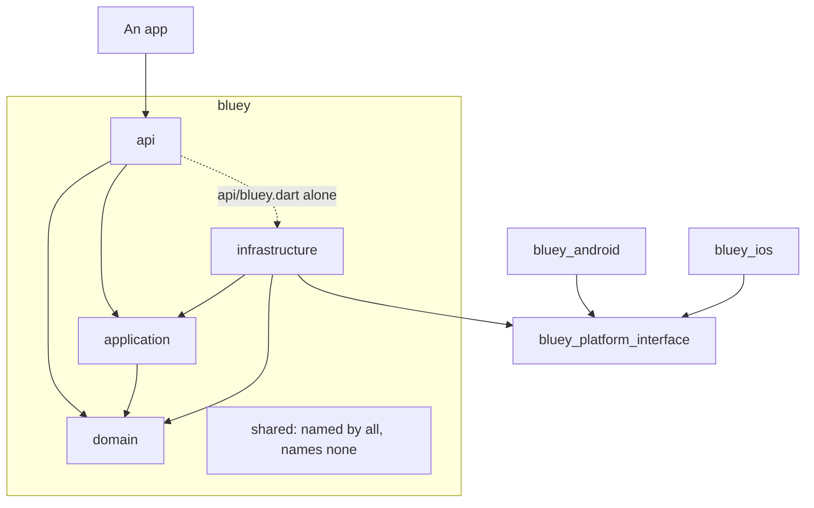

# Architecture

How Bluey's code is organized, which rules the build holds it to, and how to work with them.

## 1. What this document is

This is the authoritative guide to Bluey's structure. [`CLAUDE.md`](../CLAUDE.md) is its short version; where the two differ, this one is right and the other is fixed.

Bluey follows the structure of two Kotlin repositories: Eventur's `:common` module (bounded contexts under `features/`, each cut into `domain/`, `application/` and `infrastructure/`, beside a shared kernel) and the Charter Brief libraries (a pure core beside its adapter, architecture tests that fail the build, a committed public API dump). This guide is their translation into Dart. It borrows their structure, not their code.

The reasons and the alternatives are in the [architecture foundation design](superpowers/specs/2026-11-17-architecture-foundation-design.md). The defects the structure answers are in the [November audit](reviews/2026-11-17-correctness-and-test-rig-audit.md). This guide says what is so. The design of each later slice, with its design review, is in `docs/superpowers/specs/`.

## 2. The layout

The repository is a Dart workspace of five packages and the example app. The root `pubspec.yaml` lists all six members and pins Flutter.

```
bluey/                       The library apps depend on: the domain, the application units and the public API
bluey/example/               The demo app (scanner, connection, GATT, server), a workspace member
bluey_platform_interface/    BlueyPlatform, the federated plugin interface, its DTOs and Capabilities; and platform_implementation.dart, code the platform packages share, for them alone (a guard holds bluey/lib to it)
bluey_android/               BlueyPlatform on Android: Dart over Pigeon, Kotlin under android/src/main/kotlin
bluey_ios/                   BlueyPlatform on iOS: Dart over Pigeon, Swift under ios/Classes
bluey_guards/                The guards the build runs: architecture rules, the public API dump, the CI gate tools
```

`bluey_guards` is dev-only and never published. The four other packages name it as a path dev dependency, so nothing an app installs depends on it. It names no Bluey package: a package's name is a string its configuration hands it.

Inside `bluey`, the target layout is this:

```
bluey/lib/
├── bluey.dart                      the public exports, nothing else
└── src/
    ├── api/                        the edge: what an app calls
    │   ├── bluey.dart              Bluey: assembles every context by constructor (the composition root)
    │   ├── exceptions.dart         the sealed BlueyException family
    │   └── {context}/              public interfaces (Connection, Scanner, Server), their thin implementations, the
    │                               translation of the context's phases, events and failures into the public ones (a
    │                               failure becomes a BlueyException here, the one place one is thrown), and the
    │                               context's re-export of the value objects an app builds. Today:
    │                               connection/: Connection and its two extension interfaces; BlueyConnection, and
    │                               AndroidConnection and IosConnection over Connection's sessions; ConnectionAssembly,
    │                               which builds Connection's units over its ports and presents each link as one
    │                               Connection; Connections (one public Connection per link); BorrowedConnection (Peer's
    │                               borrow); ConnectionState and connectionStateOf; the three public connection events
    │                               and PublishedLinkEvents; connection_failure_translation.dart (ConnectionFailure and
    │                               LinkEnd to BlueyException).
    │                               discovery/: Scanner and ScanState; PublishedScanner, one public Scanner over an
    │                               OpenScanner; DiscoveryAssembly, which builds the RadioScanSession over the Scanning
    │                               port and hands out a Scanner per bluey.scanner() and peer discovery's scan function;
    │                               PublishedScanEvents and the five public scan events; ScanFailedException with its
    │                               ScanFailureReason; scan_failure_translation.dart (ScanFailure to BlueyException);
    │                               scan_state_translation.dart (ScannerPhase to ScanState).
    │                               platform/: platform.dart, which re-exports Platform's Capabilities and PlatformKind
    ├── features/
    │   └── {context}/              discovery, connection, gatt_client, gatt_server, peer, platform. Today:
    │                               connection/ holds, in domain/, Link with LinkPhase, LinkInput, LinkEnd and LinkEvent,
    │                               LiveLinks and LiveLink, LinkId, LinkOperation, LinkFeatures, ConnectionFailure, and
    │                               value_objects/ (Mtu, WritePayloadLimit, BondState, Phy, ConnectionParameters and its
    │                               three parts); in application/, LinkSession, LinkRegistry, ConnectDevice, BorrowLink,
    │                               the four sessions (BondingSession, PhySession, ParameterSession, MtuSession), the two
    │                               reads (ReadRssi, ReadWritePayloadLimit), connection_log_words.dart, and in ports/ the
    │                               six ports (Links, MtuNegotiation, SignalStrength, Bonding, PhyControl,
    │                               ParameterControl), LinkEvents and ConnectionPorts, which hands a host all of them with
    │                               LinkFeatures; in infrastructure/adapters/, one Platform adapter per port,
    │                               platformConnectionPorts, linkFeaturesFrom and the platform-error mapping.
    │                               discovery/ holds, in domain/, RadioScan (the aggregate: the radio's phase, its
    │                               scanners and their scans) with RadioPhase, RadioScanInput, RadioScanStep, RadioDuty
    │                               and ScanEvent, Scanners, ScannerScans, ScannerPhase, ScanPhase, ScanEnd, ScanAsk,
    │                               ScanFilter, ScanCoverage, ScanMode, ScanId, ScannerId, ScanFailure, and the values
    │                               Device, Advertisement and ScanResult; in application/, RadioScanSession, OpenScanner,
    │                               OpenScan, OwedScan and ScanTurns, and in ports/ Scanning and ScanEvents; in
    │                               infrastructure/adapters/, PlatformScanning and the platform scan-failure mapping.
    │                               platform/ holds Capabilities and PlatformKind (domain) and capabilitiesFrom
    │                               (infrastructure/adapters)
    │       ├── domain/             value objects, entities, state machines, events, failures
    │       ├── application/        one unit per intent, and the sessions that run a live state machine
    │       │   └── ports/          what this context needs from the radio or another context, in its own words
    │       └── infrastructure/
    │           ├── adapters/       a port answered over BlueyPlatform: DTO mapping, platform errors to failures
    │           └── bridges/        a port answered by another context
    └── shared/
        ├── domain/                 Either, Failure, BlueyEvent, DeviceAddress, UUID, ManufacturerData, RadioOutage; CharacteristicProperties to come
        ├── application/            ports every context uses: EventPublisher, Log, and what Log speaks, BlueyLogLevel and
        │                           BlueyLogEvent; Now, the clock the application is handed
        └── infrastructure/         BlueyLogger, BlueyEventBus, and the platform error classification (`platformErrorOf`, `radioOutagesOf`) that every adapter shares
```

The six contexts and their vocabulary are CLAUDE.md's: Discovery, Connection, GATT Client, GATT Server, Platform and Peer.

Most of today's code is still in the old layout, one flat folder per context. In place are the kernel's files named above, the whole Connection context but its GATT client (slice 1), Discovery (slice 2), Platform's `Capabilities`, and the edge's `connection/`, `discovery/` and `platform/`; `lib/src/bluey.dart` stays the composition root until `Bluey` itself moves to `api/`. A file moves in the slice that changes it, never on its own (section 11). A new file is born in the target layout.

A layer folder groups by role once it holds three or more files of one kind (`value_objects/`, `events/`, `failures/`). File names are Dart's `snake_case`; class names follow the Kotlin repositories (`ConnectDevice`, `PlatformScanning`, `InMemoryScanning`).

## 3. Layers

Dependencies point inward. Only infrastructure touches `BlueyPlatform`, only the edge throws for a failure, and nothing points out of the domain.



An arrow reads "depends on". The layers are `domain`, `application` and `infrastructure`, from the inside out, in each context and in the kernel alike.

| Layer | Holds | May name, besides what the layers inside it may |
| --- | --- | --- |
| `features/{context}/domain` | The context's rules as pure, synchronous Dart. A state machine takes an input and answers the new state and what to do next | Its own domain, `shared/domain`, `dart:core`, `dart:typed_data`, `dart:collection`, `dart:math`, `package:meta` |
| `features/{context}/application` | Orchestration: one unit per intent (`ConnectDevice`), the sessions that feed a state machine from a port's stream and run its timers, and the ports | Its own application, `shared/application`, `dart:async`. It reads time only through `Now` (`shared/application/now.dart`), which the composition root hands it as `clock.now`, so no clock package is named and a test drives time by hand |
| `features/{context}/infrastructure` | Adapters and bridges, and nothing that decides | Its own infrastructure, `shared/infrastructure`, `package:bluey_platform_interface`, `package:flutter/services.dart`. A bridge also names the other context's domain and application |
| `shared/{layer}` | The kernel every context uses, cut into the same three layers | The same as the layer of that name. No context, no edge, no public library |
| `api` | The public surface: interfaces, implementations that call one application unit and translate its failure, and the composition root | Every context's domain and application, the kernel's `domain` and `application`, and code that has not moved yet. Only `api/bluey.dart` names an infrastructure, a context's or `shared/infrastructure`, or a framework; every other `api/` file is handed the port it needs by constructor |

Allowances accumulate from the inside out. The table lists what each layer adds, so `application` may name everything `domain` may and its own additions, and `infrastructure` everything `application` may and its own. A file may name a file of its own context, or of the kernel, only in its own layer or one inside it: an application unit names its domain, never its adapters.

A context names no other context. The one exception is a bridge, a file under `infrastructure/bridges/`, which answers a port of its own context by calling the other context's application units. Their signatures answer the other context's domain types, so a bridge names the other context's domain and application, and never its infrastructure.

**What the kernel takes in.** A value object moves into `shared/domain` only when it is a plain identity or measure, holds no rule that belongs to one context, and is used by at least three contexts. `DeviceAddress` passes: it is an identity, it holds no context's rule, and Discovery, Connection, GATT Server and Peer all name it. Anything else stays with the context that owns it, and another context reaches it through a port of its own, answered by a bridge. Each slice's design names what it moves into the kernel and why, against this bar, so the kernel never grows by convenience.

Placed code never names unplaced code, except from `api/`. Otherwise a file could move into place and keep its old couplings. The edge has to reach the classes that have not moved yet, so it may.

**Published language.** A context speaks its own words inside and the public ones only at its edge. Its events, phases and failures are its own types (Connection's `LinkEvent`, `LinkPhase`, `ConnectionFailure`), and `api/<context>/` translates each into the public one (`ConnectingEvent`, `ConnectedEvent` and `DisconnectedEvent`; `ConnectionState`; a `BlueyException`) by a pure mapping. An aggregate raises the events it decides, stamped with the instant it is handed: `Link` answers `LinkOpenBegan` when it begins and `LinkOpened` and `LinkEnded` in the step it takes, so the application raises none of its own. Events leave the application through a port (`LinkEvents`), which the edge implements by publishing the public event with the domain's instant as its `timestamp`. A value object an app builds and hands in (`Mtu`, `Phy`, `ConnectionParameters`, `BondState`) is not translated: it is published from the domain as it stands and re-exported by the context's edge library. Events, phases and failures are translated; values are shared.

A context's edge names only its own context's code, other contexts' edges, the kernel (`shared/`) and unplaced code; the composition root alone names two contexts together. Connection's edge learns which platform extension to build from an edge enum, `ConnectionExtension`, which `lib/src/bluey.dart` maps from Platform's `PlatformKind`, and is handed the platform's name as a string. `edge contexts` holds the first half of that, and `edge from below` the reverse direction: code not yet placed does not name the edge (section 4).

A public library, `lib/<name>.dart`, is held as the edge is: it may not name a context's infrastructure or `shared/infrastructure` unless it is a composition root. Otherwise `lib/bluey.dart` could export an adapter and hand an app what the edge keeps from it.

## 4. The rules the build holds

Each package's `test/architecture/` judges its sources against the rules below on every run of its suite, and CI's Architecture job runs the four folders on their own. A rule is a pure function of the package's files, written once in `bluey_guards/lib/src/architecture/rules/`. What is particular to a package (its name, its frameworks, its allowances, its old folders) is configured beside its tests: Bluey's in [`bluey/test/architecture/bluey_architecture.dart`](../bluey/test/architecture/bluey_architecture.dart), the other three packages' size rules in their `test/architecture/size_test.dart`. Every package registers its tests through one function, `holdToKnownViolations`, so all are judged and fail in the same words: one test that the package was read from its root (a run from another folder reads an empty tree, over which an empty list would pass), then one per rule. `bluey_guards` holds itself to the size and public-exports rules the same way, with empty lists.

Each rule reads Dart through the analyzer's parser, so a directive that spans lines, a conditional import, an `export ... show` and a `part` are all read, and nothing inside a comment or a string is.

| Rule, as its test prints it | What it flags | Configured |
| --- | --- | --- |
| `placement` | A Dart file under `lib/` that is not in the target layout, and one under `lib/src/features/<name>/` where `<name>` is not one of the six contexts, so a misspelt context is never read as a seventh (`features/connectoin is not a context`) | `contexts` in `bluey_architecture.dart` |
| `boundaries` | A context file that names a file of another context, unless the source is a bridge and the target is the other context's domain or application. A kernel file that names a context file. Code in the old layout is judged by its folder: `connection`, `discovery`, `gatt_client`, `gatt_server`, `peer` and `platform` are contexts, `shared` and `log` are kernel. A public library, the edge and a file directly in `lib/src` are not judged | `LegacyLayout` in `bluey_architecture.dart` |
| `framework placement` | A file under `lib/src` that names `package:flutter` or `package:bluey_platform_interface` and is neither in an `infrastructure/` layer nor a composition root. The composition root is `lib/src/api/bluey.dart`; today's `lib/src/bluey.dart`, which becomes it, is on the list until it moves. A public library is not judged here; `public exports` holds what it exports | `frameworks` and `compositionRoots` in `bluey_architecture.dart` |
| `public exports` | A public library that exports anything but a file of its own package under `lib/src/`, or a file from inside a context (`lib/src/features/`): a context reaches apps only through its edge in `api/` | The package's name |
| `reserved libraries` | A Dart file under `lib/` that names `package:bluey_platform_interface/platform_implementation.dart`, the library through which the platform packages share code, or anything under `package:bluey_platform_interface/src/implementation/`, the sources it exports. Infrastructure, the composition root and the public library are held too, since none of them is its audience. The example app and `bluey`'s tests are not read by the architecture tests, so it does not hold them | `libraries` in `bluey_architecture.dart` |
| `layers` | A placed file that names what its layer may not (section 3): an outer layer of its own context or of the kernel, an outside library beyond its allowances, the edge, a public library, or unplaced code. An edge file or a public library that names an infrastructure, a context's or `shared/infrastructure`, and is not the composition root `lib/src/api/bluey.dart`. A dependency on another context is left to `boundaries` | `LayerAllowances` and `compositionRoots` in `bluey_architecture.dart` |
| `edge contexts` | An edge file of a context, under `lib/src/api/<context>/`, that names a file of another context under `features/`. It may name its own context's code and another context's edge, which is that context's public interface. A file directly in `api/` that names any context's file, unless it is a composition root (`lib/src/bluey.dart` or `lib/src/api/bluey.dart`). The kernel and unplaced code are not judged here | `compositionRoots` in `bluey_architecture.dart` |
| `edge from below` | A file not yet in the target layout that names a file of the edge, `lib/src/api/`, unless it is a composition root (`lib/src/bluey.dart` or `lib/src/api/bluey.dart`). Placed code is held by `layers`, and the edge may name itself | `compositionRoots` in `bluey_architecture.dart` |
| `throws` | In a placed file under `features/` or `shared/<layer>/`, a raise that is not a `throw` of a programming error, read through parentheses (`throw (StateError('x'))`). A raise is a `throw`, a `rethrow`, an `Error.throwWithStackTrace` (read as a `throw` of its first argument), a `Future.error` or `Stream.error` call or tear-off however it is written (`onError: Future.error`, `async.Future<int>.error`), and an `addError` or `completeError` call or tear-off (`onError: controller.addError`, or a bare `addError` inside a sink). The programming errors are `StateError`, `ArgumentError` and `UnimplementedError`, each with any of its named constructors (`ArgumentError.value`). An entry names the file, the raise and how often the file makes it, and no line, so an edit above a raise never rewrites the list: `lib/src/features/connection/application/connect_device.dart -> throw Gone, 2 times`, a `rethrow` as `-> rethrow, 1 time` | `programmingErrors` in `bluey_architecture.dart` |
| `lint options` | A root of new code that holds a Dart file and has no `analysis_options.yaml` directly in it, and any options file in or under such a root that does not itself turn on `unawaited_futures` and `discarded_futures` under `linter: rules:` (a list item, or `true` in a map), or that sets either to `ignore` under `analyzer: errors:`. A deeper options file replaces the root's for its folder, so it must turn both on itself. An `// ignore:` comment is not judged. The roots are `lib/src/api`, `lib/src/features`, `lib/src/shared/domain`, `lib/src/shared/application` and `lib/src/shared/infrastructure` | `roots` and `lints` in `bluey_architecture.dart` |
| `size of .dart files` | A hand-written Dart file under `lib/` longer than 300 lines, in each of the four packages | Each package's `test/architecture/` |
| `size of .kt files`, `size of .swift files` | A Kotlin file under `bluey_android/android/src/main/kotlin`, or a Swift file under `bluey_ios/ios/Classes`, longer than 400 lines | `bluey_android/test/architecture/size_test.dart`, `bluey_ios/test/architecture/size_test.dart` |

A file's length is its number of lines of text: a last line with no line break counts, and a Windows line break counts once, so a ceiling means the same on every machine. A generated file, one with `.g.` before its extension (Pigeon's `messages.g.dart`, `Messages.g.kt`, `Messages.g.swift`), is never measured.

Why the two lints: a dropped future is how a failure or a late completion goes unseen, the class of bug behind audit finding M2. Placed code turns them on in a nested `analysis_options.yaml`; the old folders keep today's lints until they are empty. A slice that puts the first file into a root adds that root's options file, copied from [`bluey/lib/src/shared/domain/analysis_options.yaml`](../bluey/lib/src/shared/domain/analysis_options.yaml).

Why `layers` is strict: its list is empty and stays empty, since placed code arrives clean (section 5). A placed file that points outward is fixed before it lands, never listed.

Why the ceilings: a ceiling stops a fix from growing a class that is already too large. The numbers are a judgment, and they apply to new code from its first line.

## 5. The lists

Today's code breaks most of these rules. What each rule finds today is written down, and the test fails when the code and the list differ in either direction. Each list is a ratchet.

| Package | File | Lists |
| --- | --- | --- |
| `bluey` | [`bluey/test/architecture/known_violations.dart`](../bluey/test/architecture/known_violations.dart) | `unplaced` (28), `boundaries` (19), `frameworkPlacement` (9), `publicExports`, `reservedLibraries`, `layers`, `throws`, `lintOptions` and `edgeContexts` (empty), `oversized` (8), `edgeFromBelow` (6) |
| `bluey_platform_interface` | [`bluey_platform_interface/test/architecture/known_violations.dart`](../bluey_platform_interface/test/architecture/known_violations.dart) | `oversizedDart` (2) |
| `bluey_android` | [`bluey_android/test/architecture/known_violations.dart`](../bluey_android/test/architecture/known_violations.dart) | `oversizedDart` (3), `oversizedKotlin` (3) |
| `bluey_ios` | [`bluey_ios/test/architecture/known_violations.dart`](../bluey_ios/test/architecture/known_violations.dart) | `oversizedDart` (3), `oversizedSwift` (2) |
| `bluey_guards` | [`bluey_guards/test/architecture/known_violations.dart`](../bluey_guards/test/architecture/known_violations.dart) | `oversized` and `publicExports` (empty) |

An entry is one line, `path -> detail`, with the path relative to the package root and forward slashes: `'lib/src/connection/bluey_connection.dart -> lib/src/gatt_client/gatt.dart'`, `'lib/src/shared/exceptions.dart -> 578 lines'`. The file holds lists and nothing else, so a diff of it is only ever a list changing. The architecture test reads the file itself, not the constants it declares: each package keys its rules by list name (`blueyRules` in `bluey/test/architecture/bluey_architecture.dart`, `packageRules` in the others' `<package>_architecture.dart`), each rule is held to the list of its name exactly as the file writes it, and a list no rule holds, or a rule whose list the file lacks, fails the test. So no list can be built anywhere but in the file. The list gate holds the file to that: a file that holds anything but top-level lists of plain strings, written as literals (a getter, a function, `[...].toList()`, a set, an `import`, `export` or `part`; a bare `library;` that carries the file's doc comment is the one directive allowed), or that does not parse, is refused, since the gate could not compare a list it cannot read.

A list only shrinks. Nothing is added to it and no count is raised: when a rule finds something new, the code is fixed. An entry leaves in the commit that fixes it. A size entry is rewritten with the lower count when its file shrinks, so the file can never grow back to its old ceiling.

The architecture test can only see that a list matches the code; a line copied into the list would make it match again. So CI's Lists only shrink job compares each list file, these five and each package's known-defect roster (section 9), with the commit where the change left its base (`git merge-base`), a pull request's base branch or, on a push to `main`, the commit `main` stood at before. A list the base did not have counts as empty, so renaming a list carries nothing in; a list the base had must still be in the file, so it cannot leave the gate's sight by moving to another file; a list file the base did not have is the first statement of what its rules find, and holds. A rule added to a list file the base already has states today's debt the same way only through `--first-statement=<list>`, a flag the change that adds the rule passes and the next change removes: a list the base lacks then holds whatever it lists, a list the base has is judged as ever and the gate prints that the flag no longer applies, and a flag naming a list no list file at the head declares fails the gate.

The gate knows no rule's entries. A rule whose entries record a debt that outlives their text says what each entry owes (a `WeighingRule`'s `weigh`), and the gate compares what each list owes at the base and at the head: a debt the base did not owe is an entry added, a debt owed more is a count raised, and a debt owed the same or less holds, however its entry is now written. Each package's `test/architecture/list_growth.dart` is the one place its rules meet the gate: it passes `weightsOf(<its rules>)` to the gate's `holdListsToShrinking`, and CI runs it in every package that has a `known_violations.dart`. A list whose rule weighs nothing, and the rosters, are held entry by entry: every entry at the head must be at the base. Three rules weigh their entries:

- **A size entry** owes its file's lines, so it may be rewritten with a lower count and never with a higher one.
- **A `boundaries` entry** owes its source file's dependency on the target's context, not on one path in it: `lib/src/gatt_client/gatt.dart -> lib/src/connection/value_objects/attribute_handle.dart` is the debt "`gatt.dart` depends on Connection". The rule reads the context through its own `LegacyLayout` and `Placement`, so `lib/src/connection/` and `lib/src/features/connection/` are the one context. For each source file and each context, the count of entries may fall but never rise.
- **A `throws` entry** owes its file's raises of one kind (`throw Gone`, `rethrow`, `addError`), so `connect_device.dart -> throw Gone, 2 times` may be rewritten as `1 time` and never as `3 times`.

This is a real run, from `bluey/` against `HEAD`, after the `gatt.dart` entry above was rewritten to `lib/src/features/connection/domain/attribute_handle.dart` (which holds), two lines were copied in for `lib/src/peer/peer_remote_service_view.dart`, which already depended on `gatt_client` once and on `discovery` not at all, and the entry of `lib/src/bluey.dart` was raised:

```
test/architecture/known_violations.dart: 1 entry added, 2 counts raised. A list only shrinks: fix the code and take the line out of the list.
Added:
  boundaries: lib/src/peer/peer_remote_service_view.dart -> lib/src/discovery/device_address.dart
Raised:
  boundaries: lib/src/peer/peer_remote_service_view.dart into gatt_client, 1 at the base and 2 at the head: lib/src/peer/peer_remote_service_view.dart -> lib/src/gatt_client/value_objects.dart
  oversized: lib/src/bluey.dart, 1002 at the base and 9999 at the head: lib/src/bluey.dart -> 9999 lines
```

The gate knows nothing of git renames: a source file that moved is a new source file, so its entries read as added.

That is the gate holding, not a gap in it. **A file placed under `features/`, `api/` or `shared/{domain,application,infrastructure}` arrives clean**: it brings no `boundaries` entry and is within its size ceiling. Debt does not follow a source file into the target layout; a slice that moves a file fixes what it does wrong on the way in, and the old path's entries leave as debt paid. A file split out of an oversized one follows the same rule: each piece is within the ceiling, and the remainder's entry is only ever lowered.

When a list and the code differ, the test prints up to three parts. This is a real run, after `lib/src/bluey.dart` shrank from 1,040 lines to 1,002 and its entry was not rewritten:

```
size of .dart files: 1 not on its list, 1 on its list that no longer holds.
On the list, but what it names changed:
  lib/src/bluey.dart shrank from 1040 to 1002 lines: lower its entry to 1002
```

And this one, after the entry of `lib/src/gatt_client/gatt.dart` was written as if its target still sat at `lib/src/connection/attribute_handle.dart`:

```
boundaries: 1 not on its list, 1 on its list that no longer holds.
On the list, but what it names changed:
  lib/src/gatt_client/gatt.dart still depends on connection, but on lib/src/connection/value_objects/attribute_handle.dart, not on lib/src/connection/attribute_handle.dart: rewrite the entry to the new path
```

- **Not on the list** is new debt: a file born outside the layout, an import across a boundary, a throw in placed code, a new file over its ceiling. Change the code until the line goes away. Never copy the line into the list. A `boundaries` entry whose target moved, within its context or out of a legacy folder into its `features/` home, is not new debt: the test tells it under the third part, below, and the entry is rewritten to the new path. A moved or split target passes as long as the source file is left with no more entries into that context than it had (a source that now imports both halves of a split target has one entry more, and fails); a dependency on a context the file did not depend on, or one more entry into a context it did, is new debt. A target that lands in `shared/` is no boundary at all: its entry is deleted.
- **On the list but no longer true** is debt paid: the file moved, was deleted or was fixed. Delete the entry.
- **On the list, but what it names changed** is a listed entry the rule reads as one thing changed, with the entry it found (the ratchet itself knows no rule's entries). For `boundaries` it is a target that moved within its context, and the line ends `rewrite the entry to the new path`. For a size list it is a listed file whose length moved, and the line says which way; for `throws`, a listed raise whose count moved, which reads `raises throw Gone 3 times, up from 2: answer the new one as a value; never raise the entry` or ends `lower its entry to 1 time`. One that shrank ends `lower its entry to <count>`: rewrite the entry with that count. One that grew reads `grew from 990 to 1002 lines: shrink the file to 990 lines or fewer; never raise the entry`: shrink the file until the test passes with the entry as it is. A count is never raised. The heading's two figures each count such a file once.

A slice that moves a file usually sees both parts at once, under several rules: the old path's entries are stale, and anything the moved file still does wrong is new. Fix the new, delete the stale, and the lists end the slice shorter than they began.

Two groups of entries can only be cleared by a named slice. The first is `bluey_platform_interface`'s `lib/src/platform_interface.dart -> 854 lines`, nearly all of it the one `BlueyPlatform` class, cleared by slice 3, which splits it into one interface per role. The second is the six `edgeFromBelow` entries, Peer's imports of the public `Connection` and of `BorrowConnection`, which leave with slice 5. A third, `lib/bluey.dart`'s re-export of the platform interface's `Capabilities`, left `public exports` with slice 1, which gave Bluey its own; that list is now empty.

## 6. Failures as values

Below `api/`, a failure a caller can meet is answered as `Either<Failure, T>` and never thrown. `api/` is the one place that turns a failure into a `BlueyException`, so an app keeps the exceptions a Flutter caller expects while every signature inside says what can fail.

```dart
// features/connection/application/connect_device.dart
Future<Either<ConnectionFailure, LinkSession>> run(ConnectDeviceRequest request)

// api/connection/connection_assembly.dart, which Bluey.connect calls
final answer = await _connectDevice.run(
  ConnectDeviceRequest(device: device, timeout: timeout),
);
return _connections.of(
  valueOrThrow(answer, device: device, platform: _platformName),
);
```

`valueOrThrow` and `connectionFailureAsException`, in `api/connection/connection_failure_translation.dart`, answer the value or throw the exception an app gets today, so moving an operation below the edge changes nothing an app catches.

- **`Either`** is Bluey's own sealed type in [`shared/domain/either.dart`](../bluey/lib/src/shared/domain/either.dart): `Left` holds the failure, `Right` the success, `fold` reads both and `map` changes a success. No package is added for it.
- **`flatMap`** chains a step that can itself fail. It is an extension, `EitherFlatMap`, not a member. A member's parameter type would be fixed by the receiver's left type, so a caller holding an `Either<ConnectionFailure, T>` as an `Either<Failure, T>` would fail at run time when its next step answered a different failure. An extension is resolved against the static type the caller holds. There is no `mapLeft`, since no unit needs one yet, and no extension on `Future<Either>`. `flatMapAsync`, an extension of the same kind (`EitherFlatMapAsync`), chains a step that answers later; it arrived with its first caller, Connection's MTU session.
- **`Failure`** is an interface in [`shared/domain/failure.dart`](../bluey/lib/src/shared/domain/failure.dart) with one member, `message`, a sentence for a person or a log that no caller parses. Each context declares its own sealed family in its `domain/` (Connection's is [`ConnectionFailure`](../bluey/lib/src/features/connection/domain/connection_failure.dart); Discovery's is [`ScanFailure`](../bluey/lib/src/features/discovery/domain/scan_failure.dart)), because Dart seals a family within one file. A failure carries typed fields, never a map.
- **The translator** of each context sits with that context's edge (Connection's is `api/connection/connection_failure_translation.dart`, Discovery's `api/discovery/scan_failure_translation.dart`, which turns a `ScanFailure` into a `ScanFailedException`, a `PermissionDeniedException`, a `BluetoothUnavailableException` or a `BlueyPlatformException`) and switches exhaustively over its family, so a new failure with no public exception fails to compile. `LinkGattClient`, GATT Client's code still in the unplaced `connection/bluey_connection.dart`, does not name it: `ConnectionAssembly` hands each client a `BlueyException Function(LinkEnd)` to throw a link's end with, so the unplaced file imports nothing under `api/`, and the Android and iOS surfaces are composed at the edge (`AndroidConnection`, `IosConnection`). The edge still names that file, for the `LinkGattClient` type the assembly builds through `gattFor`, which the edge may do; slice 6 replaces it with GATT Client's own port.
- **Adapters** catch everything `BlueyPlatform` throws and answer a failure. A throw they do not recognise becomes an `UnexpectedPlatformFailure` that carries the cause; it is never swallowed.
- **Streams** below `api/` carry no errors. A stream whose source can fail ends through its owner's terminal state or carries `Either`; each port's design says which. Connection's `Links` ends its stream: when the platform's state stream for a link fails, `PlatformLinks` logs it, ends the link's reports, which the lifecycle reads as a drop, and asks the platform to disconnect, best effort, since nothing else is left able to close that link.
- **Input is parsed.** Bytes and values that arrive from the radio, the platform or a remote peer go through a factory that answers `Either` (`LifecycleInterval.of`). A throwing constructor is only for a value the app's programmer wrote (`UUID('180d')`).
- **Programming errors still throw.** A broken invariant is a `StateError`, as `error(...)` is in the Kotlin repositories. The `throws` rule allows exactly `StateError`, `ArgumentError` and `UnimplementedError`.

`Either` and `Failure` are not exported from `lib/bluey.dart`; they are internal vocabulary. The translator and the first family, `ConnectionFailure`, arrived with slice 1. `shared/exceptions.dart` does not move to `api/` in slice 1: the translator names it where it is, and at 578 lines it cannot arrive in `api/` without splitting a sealed family, which deserves its own look. Until a context moves, both models coexist: an unplaced file keeps throwing, and a placed file is held to values by the `throws` rule.

## 7. State and ports

Three rules answer the audit's three structural causes, and every slice's design is reviewed against them.

| Rule | What it means | Findings it answers |
| --- | --- | --- |
| One owner per state | Scanning, advertising, each link and the set of live links are each one state machine in one context's domain. A platform stream is an input to that machine, never a second copy of the state in an adapter or a native class | M2, M3, M4, M5, M8, L1, H2 |
| Completion by identity | An operation that crosses to native code and completes later carries an id its caller minted. A completion names that id, and one that names an unknown id is logged and dropped | H1, M1, I063, I359 |
| Teardown is a transition | Reaching a terminal state releases every resource, whatever caused it. `disconnect()` and `dispose()` request the same transition a remote disconnect causes | H3, I369, L4, L5 |

A `LinkId` is not such an id. It is the platform's name for a link, and on today's platforms successive links to one device carry equal ids, so nothing keyed by a `LinkId` may outlive its link: once the link has ended, its id may already name the next one. Below the platform interface the same holds by device: `DeviceStreams`, which both platform packages take from `bluey_platform_interface`'s library for them (`platform_implementation.dart`), keeps a signal about an ended link (its disconnect's answer, its last report) from touching the device's next link.

A domain state machine is synchronous and holds no timer, so it can be driven by random input sequences in a test. The application session around it owns the timers and the streams.

**Ports.** A context declares what it needs in `application/ports/`, in its own language, answering `Either`: Discovery asks for `Scanning`, not for `BlueyPlatform`. The exact ports are settled in the slice that moves the context, never ahead of it.

**Adapters.** An adapter in `infrastructure/adapters/` answers a port over `BlueyPlatform` (`PlatformScanning`). It maps DTOs and errors and decides nothing. `BlueyPlatform` stays the federated plugin interface that Android and iOS implement; it is infrastructure's dependency, not the domain's.

**Bridges.** When one context needs another, it declares a port and a bridge answers it from the other context's application units. Peer reaches a link through its own `PeerLink` port, never by importing Connection. Until slice 5 places Peer, its unplaced files name the public `Connection` at the edge (`api/connection/`) and are handed a borrow function, `BorrowConnection`, by the composition root. The `boundaries` rule reads the edge as no context, so that dependency is on no list.

**The composition root.** `api/bluey.dart` assembles everything by constructor. There is no container and no singleton, and it is the one edge file that names an infrastructure, a context's or the kernel's; it hands every other edge file its ports by constructor.

**Contract suites.** Every port has a suite of the promises it makes, kept in `test/fixtures/` and run against its in-memory double and against its adapter over `FakeBlueyPlatform`. A unit test that passes against the double then means the same thing against the adapter. `BlueyPlatform` gets a suite of its own that `FakeBlueyPlatform` and the Android and iOS Dart adapters all pass; that is slice 3.

## 8. Native packages

Kotlin and Swift make the split Charter Brief makes between a pure core and its adapter.

- **Kotlin** leaves its single package for one package per context, named as in Dart. The logic that decides (the operation queue, registries, state machines) is plain Kotlin that imports no `android.*`, and the classes that touch `BluetoothGatt` are adapters around it.
- **Swift** makes the same split with protocol seams: the core decides, and the classes that touch CoreBluetooth adapt it.
- The pure cores are what tier 2 of the audit's test rig drives with a simulated peer, so the structure and the rig need the same change. Slice 4 makes it.

Every Kotlin and Swift source is held to 400 lines by the size rules (section 4). Five native files are over it today and sit on their package's list with their count as the ceiling: `BlueyPlugin.kt`, `ConnectionManager.kt` and `GattServer.kt` in `bluey_android`, `CentralManagerImpl.swift` and `PeripheralManagerImpl.swift` in `bluey_ios`.

## 9. Tests

A test file mirrors its source file's path: `lib/src/features/connection/domain/link.dart` is tested by `test/features/connection/domain/link_test.dart`. Existing tests move with their source.

A `group` names the scenario, and each test inside it is laid out with `// arrange`, `// act` and `// assert`. A phase comment is left out only when the phase has no statement.

Application units are tested against in-memory doubles of their ports (`InMemoryScanning`), kept in `test/fixtures/` under the same tree, never against mocks. `FakeBlueyPlatform` stays, for adapter tests and for the integration tests that run whole scenarios through `api/`. [`testing-conventions.md`](testing-conventions.md) holds the rules for simulated time and the fake's scenario surface.

**Known defects.** A known defect is a test that reproduces an audit finding and fails until the slice that owns it fixes the bug. The November audit wrote eleven; slice 1 fixed four of them (the two H3 tests, H2 and M3) and slice 2's scanning pull request four (M2, both M4 tests and M5), and three remain, all in [`bluey/test/known_defects/domain_known_defects_test.dart`](../bluey/test/known_defects/domain_known_defects_test.dart), each named by its finding and backlog id (`M7 (I384): ...`). M3 and M2 kept the mocktail mocks they were written with when they moved into `bluey_android`'s `android_connection_manager_test.dart` and `android_scanner_test.dart`.

- **The tag.** Each file opens with `@Tags(['known-defect'])`. The package's `dart_test.yaml` declares the tag with a skip reason, so a normal `flutter test` shows each file as one skipped suite and stays green.
- **The roster.** Each package names its known defects in `test/known_defects/roster.dart`, one `knownDefects` list of full test names, group and test together (`'M7 (I384): server request with no handler attached a read with no readRequests listener is answered'`). A roster is a list as section 5's are: it only shrinks, and the Lists only shrink job holds it to that.
- **The run.** CI's Known defects job runs them with `flutter test test/known_defects --run-skipped --tags known-defect --reporter json`, and `bluey_guards:known_defects` reads the output against the package's roster. It fails when a known defect passes, when one does not run to a result (a file that no longer compiles, a failing `setUpAll`), when the run produced nothing, when the log stops before the reporter's last event, `done`, so a run cut short never hides the known defects it did not reach, when a name on the roster is not in the run (a test deleted or renamed), and when a test in the run is not on the roster. A still-failing known defect is what it expects, and the verdict prints the first line of its first error beside its name.
- **The fix.** A fix slice starts by moving its test out of the known-defect file into the mirrored tree, where it fails: that is its red step. The fix makes it pass. The move, the fix and the name struck from the package's roster land in one commit, so the normal suite never holds a failing test and the Known defects job never sees a passing one. When a package's last known defect is fixed, the same commit deletes its known-defect file, its roster and its `dart_test.yaml` tag and takes its run, its roster and its JSON file out of the Known defects job, since an empty run reads as "the run produced no result"; the job goes with the last package.

A finding traced by reading has no test yet. It gets one as the red step of its own slice.

## 10. Gates

Every pull request runs the jobs of [`.github/workflows/ci.yml`](../.github/workflows/ci.yml), and so does every push to `main`. XCTest runs from [`.github/workflows/ios.yml`](../.github/workflows/ios.yml). Before its gate, every job runs the setup action, [`.github/actions/setup`](../.github/actions/setup/action.yml), which installs the pinned Flutter and runs `flutter pub get`. A red gate is fixed, never skipped, tagged away or made non-blocking. Each command below runs from the repository root.

| Gate | Command | CI job |
| --- | --- | --- |
| Analysis, and a lockfile that resolves as committed | `flutter pub get && test -z "$(git status --porcelain)" && flutter analyze`, at the repository root; the status check fails on a changed file and on a new one | Analyze |
| Formatting of the guards, the lists and placed code | `dart format --output=none --set-exit-if-changed bluey_guards */test/architecture */test/known_defects bluey/lib/src/api bluey/lib/src/features bluey/lib/src/shared/domain bluey/lib/src/shared/application bluey/lib/src/shared/infrastructure`, at the repository root (every package's architecture tests, list files and known defects, and every root of new code); CI passes each root only when it exists, and today all five do. The old folders keep their layout until their code moves | Analyze |
| The Dart suites | `flutter test` in `bluey_platform_interface`, `bluey_android`, `bluey_ios`, `bluey/example` and `bluey_ios/example`; `dart test` in `bluey_guards`; after each, `git diff --exit-code -- '*pubspec.lock'`, since `bluey_ios/example` resolves against its own lockfile when its suite runs | Tests (bluey_platform_interface), Tests (bluey_android), Tests (bluey_ios), Tests (bluey_guards), Tests (bluey/example), Tests (bluey_ios/example) |
| The `bluey` suite and its two coverage floors | `cd bluey && flutter test --coverage && dart run bluey_guards:coverage_gate coverage/lcov.info 90 lib`, the whole package at 90%; then `dart run bluey_guards:coverage_gate coverage/lcov.info 95 lib 'lib/src/features/*/domain' lib/src/shared/domain`, the domain at 95% (a `*` stands for any one folder). Each also fails on a file under its scope with code that no test loads. A scope that holds no line at all passes and says `the 95% floor holds nothing yet`, since the domain folders fill in as contexts move; today `features/connection/domain`, `features/platform/domain` and `shared/domain` hold 472 lines, all covered | Tests and coverage (bluey) |
| The architecture rules | `flutter test test/architecture` in each of `bluey`, `bluey_platform_interface`, `bluey_android` and `bluey_ios` | Architecture |
| No list grew | `git fetch origin main && cd bluey && dart run test/architecture/list_growth.dart origin/main test/architecture/known_violations.dart test/known_defects/roster.dart`, and the same in each package with a `known_violations.dart` (its roster only where it has one) | Lists only shrink |
| The public API dump | `cd bluey && dart run bluey_guards:public_api lib/bluey.dart api/bluey.api` | Public API |
| The Kotlin unit tests | `cd bluey_android/android && FLUTTER_ROOT="$(dirname "$(dirname "$(which flutter)")")" ./gradlew test` | Kotlin tests |
| The known defects | below | Known defects |
| The XCTest suite | `cd bluey_ios/example && flutter build ios --config-only && (cd ios && pod install)`, then `xcodebuild test` in `bluey_ios/example/ios` (CLAUDE.md has the whole command) | XCTest, in `ios.yml`: on a pull request that touches `bluey_ios/`, `ios.yml` or the setup action, every night, and on demand |

Branch protection on `main` should require every job of `ci.yml` (it requires none until it is switched on in the repository's settings): Analyze; Tests (bluey_platform_interface), Tests (bluey_android), Tests (bluey_ios), Tests (bluey_guards), Tests (bluey/example) and Tests (bluey_ios/example); Tests and coverage (bluey); Architecture; Lists only shrink; Public API; Kotlin tests; Known defects. XCTest is not required, since `ios.yml` runs only for the pull requests that touch iOS.

The known defects, run as the job runs them:

```bash
(cd bluey && flutter test test/known_defects --run-skipped --tags known-defect --reporter json > "${TMPDIR:-/tmp}/bluey.json")
(cd bluey && dart run bluey_guards:known_defects \
  test/known_defects/roster.dart "${TMPDIR:-/tmp}/bluey.json")
```

The test run exits non-zero, as expected of known defects; the verdict is the third command's. Each JSON file is judged against the roster before it. It prints, for each file, how many are still failing, now passing and not run, each still-failing test with the first line of its first error, so the log shows it fails for the defect its name gives, and names each one that fails the gate with what to do.

The `bluey` suite runs once in CI, in the job that holds the two coverage floors, and the Architecture job runs the four `test/architecture` folders again on their own, so a broken rule reads as "Architecture" in the checks list. The coverage floor is 90% of lines in the `bluey` package, the figure CLAUDE.md requires; a missing report fails too. A report names only the libraries a test loaded, so the gate is also given `lib` and fails naming every Dart file under it that the report lacks and that holds code that runs: a body, a constructor (even a `const` one with no body) or a variable that is not a constant and has an initializer. A file of enum values, abstract members or exports holds none and is absent from every report; today 28 of the 117 files under `bluey/lib` are such files.

**Where the gates stand.** On Flutter 3.47.2 every Dart gate is green: the `bluey` suite holds 1,780 tests (and one skipped) at 94.5% line coverage (3,566 of 3,772 lines) against its 90% floor, its domain is at 100% (472 of 472 lines) against its 95% floor, `bluey_guards` holds 275 tests, and the example app's suite 245. The example is the one consumer of the public API in the repository, so its suite is what sees a change to the API break an app's behaviour, which analysis alone does not. `bluey_ios/example` has its own lockfile, outside the workspace, and one smoke test. The Kotlin suite (114 JVM tests, run on the debug and the release variant) and the XCTest suite (83 tests) were green on Joel's Mac at `a41a2de`, with Xcode 26.6; neither of slice 1's pull requests changed a native file.

**The Flutter pin.** Flutter is pinned by one line, `flutter: 3.47.2` under `environment:` in the root `pubspec.yaml`. Pub reads it as a floor, so an older Flutter refuses to resolve; CI installs exactly that version from the same line, so CI is the exact gate. The workspace lockfile, `pubspec.lock` at the root, is committed, so every checkout and CI resolve alike. To move the pin: change that one line, install that Flutter, run `flutter pub get` at the root, and commit `pubspec.yaml`, `pubspec.lock` and any other file the tool rewrote. The Analyze job fails when resolving changes the committed tree, so nothing the tool writes may be left out.

**The public API dump.** [`bluey/api/bluey.api`](../bluey/api/bluey.api) is the text of everything `lib/bluey.dart` exports: one block per declaration, by name, with its members and their signatures, `const` and `factory` on constructors and `static`, `late`, `const` and `final` on fields and top-level variables. The text depends on what is exported, never on the order it is written in, so moving code behind the facade changes nothing in it, while a changed parameter, a dropped `const` or a name newly hidden by `show` does. The check exits 0 when the two agree. Otherwise it prints each removed line with `- `, each added line with `+ `, then `The public API changed. If that was meant, run this command with --write and review the dump as an API change.` After a change that was meant:

```bash
cd bluey && dart run bluey_guards:public_api lib/bluey.dart api/bluey.api --write
```

Commit the rewritten dump with the change, and review its diff as the API change it is: a removed or changed line can break an app that uses it, an added line cannot. The command refuses, with exit 1 and the errors, a library that does not fully resolve or whose dump would name `InvalidType`, as when a package is read before `flutter pub get`; it never writes a broken dump.

Two changes do not show in the dump. It lists the members a declaration declares, not those it inherits, so a member that comes from a supertype the library does not export is unseen (none does today). And it names each type as it is written, not the package that declares it, so replacing a re-exported type with a type of the same name and shape (slice 1's `Capabilities`) shows no diff, though for an app that imports both packages the type is no longer the same one. Review such a change by its code, not by the dump.

**The Gradle wrapper.** The wrapper is not in the repository (`bluey_android/android/gradle/` and `gradlew` are git-ignored, as Flutter's templates leave them), so CI installs Gradle 8.14 with `gradle/actions/setup-gradle` and runs `gradle test` after `flutter precache --android`. On a fresh checkout, create the wrapper once, with a Gradle installed:

```bash
cd bluey_android/android && gradle wrapper --gradle-version 8.14
```

## 11. Where today's code goes

Each move happens in the slice that changes the code, never on its own.

| Today | Target |
| --- | --- |
| `bluey.dart`; `Connection`, `Scanner`, `Server` and the `Remote*` interfaces with their `Bluey*` implementations | `api/`, with the logic they hold moved down into application units and domain state machines |
| `shared/exceptions.dart` | `api/exceptions.dart`, in a later slice (section 6); each context gains its own sealed failures in `domain/` |
| `events.dart` | Each context's `domain/events/`, each family under a `BlueyEvent` marker |
| `lifecycle.dart`, `connection/lifecycle_client.dart`, `connection/peer_silence_monitor.dart`, `gatt_server/lifecycle_server.dart` | `features/peer/`, which owns both halves of the lifecycle protocol |
| The `_map*` methods and `connection_parameters_mapper.dart` | Each context's `infrastructure/adapters/`. Connection's moved in slice 1 (the five adapters beside `PlatformLinks`), and the mapper file is gone |
| `connection/value_objects/` but `attribute_handle.dart` (`Mtu`, `WritePayloadLimit`, `BondState`, `Phy`, `ConnectionParameters` and its three parts) | `features/connection/domain/value_objects/`, re-exported through `api/connection/connection.dart`. Moved in slice 1; `attribute_handle.dart` stays for GATT Client's slice |
| `shared/error_translation.dart` | `shared/infrastructure/` for platform errors to failures; `api/{context}/{context}_failure_translation.dart` for failures to exceptions |
| `log/`, `event_bus.dart` | A port in `shared/application`, the implementation in `shared/infrastructure`; `BlueyLogLevel` and `BlueyLogEvent`, what the `Log` port speaks, live beside it in `shared/application` (moved in slice 1) |
| `Capabilities`, which `lib/bluey.dart` re-exported from `bluey_platform_interface` and which `Mtu` and `Bluey.capabilities` named | Moved in slice 1: Bluey's own `Capabilities` value object, with `PlatformKind`, in `features/platform/domain`, mapped from the platform interface's type by `capabilitiesFrom` in `features/platform/infrastructure/adapters/`, as `PlatformDevice` becomes `Device`, and exported through `api/platform/platform.dart`. It is Platform's, not the kernel's; Connection is handed the few facts it needs as its own `LinkFeatures`, which `linkFeaturesFrom` maps in Connection's own adapters, and `Mtu` names neither |
| The other files of each context folder (`connection/`, `discovery/`, `gatt_client/`, `gatt_server/`, `peer/`, `platform/`) and of `shared/` | The layer of `features/{context}/` or `shared/` their content belongs to |

The slices, in order. Each gets its own short design with its own design review, and the [roadmap](roadmap.md) tracks the items each one closes.

1. **Link lifecycle.** Connection in the target layout: a link state machine that owns teardown, a registry of live links, the `Links` port and its adapter, and Bluey's own `Capabilities`. Done, in two pull requests.
2. **Scanning and advertising sessions.** Discovery in the target layout, and an advertising session inside GATT Server. Scanning is done (pull request 1); advertising follows in pull request 2.
3. **Platform contract suite and invariants.** `BlueyPlatform` split into one interface per role, a `bluey_testing` package with `FakeBlueyPlatform`, the `BlueyPlatform` contract suite and random-sequence invariant tests over the state machines of slices 1 and 2.
4. **Native completions.** Kotlin and Swift pure cores, and operation ids across Pigeon.
5. **Server and Peer.** GATT Server free of the lifecycle protocol, and Peer owning both halves of it through ports and bridges.
6. **What is left.** GATT Client and Platform placed, every list empty.

Slice 3 comes before slice 4 so that the native changes are proved against the port's promises. When slice 6 ends every list is empty, and `LegacyLayout`, the one unit that knows today's folders, is deleted with them.

## 12. Design review before execution

Every spec and every plan carries a "Design review (cohesion, coupling, DDD, Clean Architecture)" section that ends `Verdict: ready.` before any task starts: each unit's single responsibility, each dependency and its direction, the bounded context and its language, and the layer each file lands in. A claim that names an existing class is checked against that class's source before the verdict is written. A finding is fixed in the document before any task starts.
