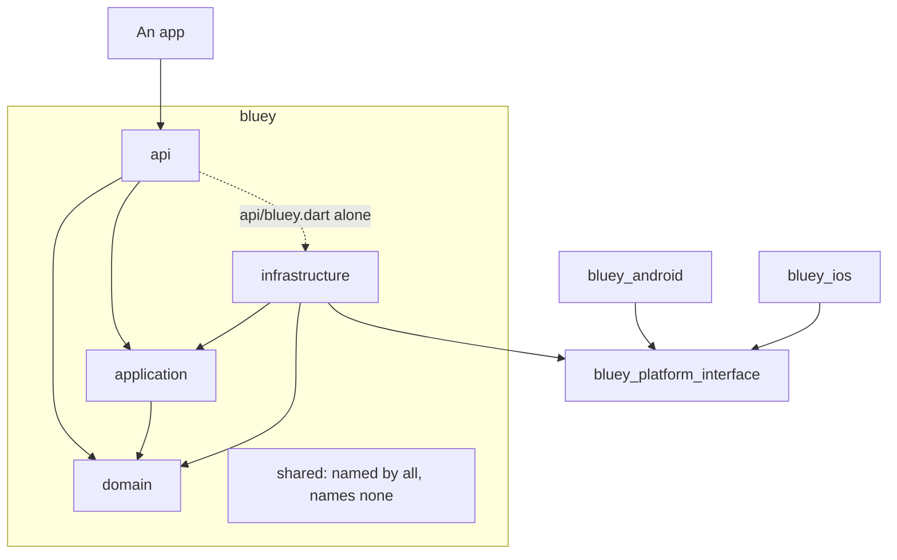

# Bluey architecture foundation: implementation plan

- **Date:** 2026-11-17
- **Document:** https://claude.ai/artifact/U93DVqvXWAN2pt1XPYbd5R

> **For agentic workers:** REQUIRED SUB-SKILL: Use superpowers:subagent-driven-development (recommended) or superpowers:executing-plans to implement this plan task-by-task. Steps use checkbox (`- [ ]`) syntax for tracking.

**Goal:** Write Bluey's target structure down and make the build hold it, so every later slice lands its code in its final place and none can make the structure worse.

**Architecture:** A dev-only workspace package, `bluey_guards`, holds the rules that read source files (placement, boundaries, framework placement, layers, throws, size), one ratchet, the public API dump and two small CI gate tools. Each package's `test/architecture/` configures the rules and keeps its lists of known violations. `Either` and `Failure` are the first files born in the target layout. GitHub Actions runs every gate on the Flutter version the root `pubspec.yaml` pins.

**Tech Stack:** Dart 3.13 on Flutter 3.47.2, `flutter_test`, `package:test`, `package:analyzer` 12.1.0 (its parser and element model, used by the dev-only package alone), GitHub Actions, Gradle with JUnit for Kotlin, `xcodebuild` for XCTest.

**Spec:** [Bluey architecture foundation: design](https://claude.ai/artifact/NQnyEBwsoUjgTozbtw9zG2), which Task 2 commits as `docs/superpowers/specs/2026-11-17-architecture-foundation-design.md`. "The design" below means that document. The audit it builds on is [Bluey audit: correctness and hardware-free testing](https://claude.ai/artifact/R6G8npke9CKEDaAakFyR7a).

**Starting point:** commit `a41a2de` on branch `claude/project-thread-23k8t8`. Nothing below is executed until Joel approves this plan.

## Global Constraints

Every task keeps these, whether or not it repeats them.

- **Flutter `3.47.2`.** Every command below assumes it is first on `PATH`.
- **No behaviour changes.** No existing Dart, Kotlin or Swift source line under any `lib/`, `android/src/main/` or `ios/Classes/` is edited. The only new files under `bluey/lib/` are `src/shared/domain/either.dart`, `src/shared/domain/failure.dart` and `src/shared/domain/analysis_options.yaml`.
- **No public API change.** `bluey/lib/bluey.dart` is not edited, and `Either` and `Failure` are not exported from it.
- **No audit finding is fixed.** A test that reproduces a finding is committed as a known defect and stays failing.
- **Test first.** No production or tool code is written without a failing test that drove it. A config file, a workflow file or a document is checked by the command its task names.
- **Test style.** A `group` names the scenario, and each test is laid out with `// arrange`, `// act`, `// assert`; the test code in this plan shows the values and assertions and leaves those three comments to the implementer. New tests use in-memory values and doubles, never mocks. The two `bluey_android` known-defect tests keep the mocktail mocks they were written with, as that suite's existing tests do.
- **Comments say why, never how.** Each public class and function carries a doc comment that says why a reader would use it.
- **New code obeys the rules it introduces.** No new Dart file exceeds 300 lines, and the new files under `bluey/lib/src/shared/domain/` pass every architecture rule with no list entry.
- **Dependencies.** `bluey_guards` declares `analyzer: ^12.1.0` and `path: ^1.9.0`, with `test: any` and `lints: ^5.0.0` for development. The lockfile already resolves all four (analyzer 12.1.0, path 1.9.1, test 1.31.1, lints 5.1.1). The four existing packages gain `bluey_guards` as a path dev dependency and nothing else. Nothing is added to any package's `dependencies`.
- **Paths in lists** are relative to the package root, with forward slashes: `lib/src/connection/bluey_connection.dart`.
- **Git.** One branch, `claude/project-thread-23k8t8`, one pull request, one commit per task. Commit subjects are plain imperative sentences, as in the repository's history (`Add the architecture rules and their ratchet`).
- **A red gate stops the slice.** No test is skipped, tagged away or made non-blocking to get a green run. A build or configuration cause is fixed in this slice. A failing test is filed in the backlog and brought to Joel before the slice goes on.

## Review Focus

Five conditions the design implies and a careless build would miss, most likely first. Each has its test in the task named.

1. **A file moves or is deleted while its entry stays on a list.** Every later slice does this. The test must fail, name the stale entry and say to delete it. (Task 5, `Ratchet`; Task 6 checks it on the real lists.)
2. **A directive or a throw the reader could misread.** A conditional import, an `export ... show`, a directive that spans lines and a `part` are all named. The words `import`, `throw` or `addError` inside a comment or a string are not. (Task 4, `DartSource`.)
3. **A known-defect suite that no longer loads, or a run that produces no result.** A later slice renames an API and the suite stops compiling. That must not read as "still failing as expected". (Task 9, `KnownDefectRun`.)
4. **A file with no final line break, with Windows line breaks, or empty.** Its line count is its number of lines of text, so a ceiling means the same on every machine. (Task 4, `SourceFile`.)
5. **A public API change that the dump could hide, or noise that it could report.** Reordering declarations changes nothing in the dump. A name hidden by `show`, or a private one, is absent. A changed parameter changes it. (Task 8, `dumpPublicApi`.)

## Rulings

The design left the mechanisms to the builder. These are the choices this plan makes, each checked by an experiment at `a41a2de` on Flutter 3.47.2. The first four differ from a sentence in the design, and Joel should read those.

| # | Ruling | Why | What the design said |
| --- | --- | --- | --- |
| 1 | The rules live in a new dev-only workspace package, `bluey_guards`. Each package's `test/architecture/` holds only its configuration and its lists | The size rule now spans four packages, the rules need unit tests of their own, and the API dump and the CI gate tools need a tested home. It is never published and no app depends on it | "An architecture test in `bluey/test/architecture/` ... needs no new dependency." Nothing new is resolved: `analyzer` 12.1.0 is already in the lockfile through Pigeon |
| 2 | The rules read Dart through the analyzer's parser (`parseString`), not by scanning lines | The language's own parser already knows comments, strings, conditional imports and directives that span lines. A prototype over `bluey/lib` reproduced every count below | "It reads each file's `import` and `export` lines" |
| 3 | One ratchet serves every list, sizes included. A size entry reads `path -> 1657 lines` and must equal today's count | A file that grows fails. A file that shrinks also fails until its entry is lowered, so it can never grow back to an old ceiling | "The file may shrink and may not grow" |
| 4 | A bridge may name the other context's domain as well as its application | A bridge calls the other context's application units, and their signatures answer that context's domain types | "A bridge also names the other context's application." The design's layer table is amended to match |
| 5 | Placed code never names unplaced code, except from `api/` | Otherwise a file could move and keep its old couplings. `api/` is the edge and must reach classes that have not moved yet | Silent |
| 6 | Layer allowances accumulate from the inside out: `application` may name what `domain` may, plus its own additions, and `infrastructure` likewise | The table lists what each layer adds | Listed per layer |
| 7 | `lib/bluey.dart` exporting another package is its own rule, "public exports", with a list of one entry | Each rule checks one thing | Folded into framework placement |
| 8 | Flutter is pinned by `flutter: 3.47.2` under `environment:` in the root `pubspec.yaml`. Pub reads it as a floor, and CI installs exactly that version from the same line | Pub cannot enforce an exact Flutter version. An older Flutter refuses to resolve, and CI is the exact gate | "A pinned Flutter version" |
| 9 | Known-defect tests carry a tag that skips them, and their job runs them with `--run-skipped --tags known-defect` | An exclusion written in `dart_test.yaml` cannot be lifted from the command line | "The normal gate leaves the tag out" |
| 10 | The Gradle wrapper stays out of the repository, as Flutter's templates leave it. CI installs the Gradle version Joel's local wrapper names | It avoids committing a binary jar. CLAUDE.md gains the one command that creates the wrapper on a fresh checkout | Silent |
| 11 | The `bluey` suite runs once in CI, in the job that also holds the coverage floor. The architecture tests get a job of their own as well as running inside each suite | A broken rule then reads as "Architecture" in the checks list | "The architecture test" is listed as its own gate |

**What needs Joel.** Task 1 runs on his Mac, through a Remote Control session he approves once, or by hand with the commands it lists. After the pull request merges, branch protection that requires the CI jobs is his to switch on in GitHub's settings. The ratings the design proposed (I308, I309, I372 and I373 to Medium) were approved with it and are applied in Task 11.

## Design review (cohesion, coupling, DDD, Clean Architecture)

The review the design requires of every plan, made before any task starts.

- **Bounded context and language.** The six contexts and their glossary do not change, and no domain term is added. `bluey_guards` is tooling with a small language of its own, used with one meaning in its code, its messages, the lists and `docs/ARCHITECTURE.md`: source file, source tree, placement, layer, context, kernel, edge, bridge, composition root, rule, violation, list, entry, ratchet, verdict, dump, gate, known defect. `Either` and `Failure` belong to the shared kernel and name no context.
- **Each unit's single responsibility.** `SourceFile` is one file's path, text and line count. `SourceTree` is the files of one package. `DartSource` says what a Dart file names and where it raises. `Placement` says where a path sits in the target layout, and `Dependency` what a URI points at. Each of the eight rules flags one kind of violation. `Ratchet` compares what was found with what is known, and knows no rule. `LegacyLayout` is the one unit that knows today's folders, and it is deleted when the lists are empty. `dumpPublicApi` writes the exported surface as text; `ApiDifference` compares two such texts. `LineCoverage` reads a coverage report; `KnownDefectRun` reads one test run. Each command in `bin/` reads its files, calls one unit and sets the exit code. `bluey_architecture.dart` configures the rules for Bluey; `known_violations.dart` holds lists and nothing else, so a diff of it is only ever a list changing. Each CI job runs one gate.
- **Cohesion.** The rules sit in one folder, one per file, each with its test beside the others. What is specific to Bluey (its package name, its frameworks, its allowances, its old folders) sits with Bluey's tests, not in the rules. The three subjects of `bluey_guards` (architecture, public API, gates) are three folders that do not name one another.
- **Dependencies and their direction.** `bluey_guards` depends on `analyzer` and `path` and names no Bluey package: a package is a string it is given. The four packages name it from their tests alone, as a dev dependency. No file under any `lib/` of the four packages names it, so nothing an app installs changes. Inside it, a rule names the reading vocabulary of Task 4 and never the other way, and nothing names `bin/`. `either.dart` and `failure.dart` import nothing.
- **Layers.** `Either` and `Failure` land in `bluey/lib/src/shared/domain`, the first files in the target layout, and pass every rule with no list entry. Everything else is outside Bluey's layers: tooling in `bluey_guards`, configuration and lists under each package's `test/architecture/`, known defects under `test/known_defects/`, the dump beside the package, workflows under `.github/`, documents under `docs/`. Inside `bluey_guards` every rule is a pure function of a `SourceTree`, which is why its tests build trees in memory. The disk is touched in three places only: `SourceTree.read`, `dumpPublicApi` and `bin/`.
- **No abstraction ahead of its shape.** `ArchitectureRule` is an interface because eight rules implement it today and one loop judges them. The three commands share no base type, the gates share no "gate" interface, and no rule takes a plug-in. No port, adapter, bridge or state machine is written in this slice.
- **Against the design.** Its seven deliverables map to tasks: the guide and CLAUDE.md (12), `Either` and `Failure` (7), the architecture test with its lists, the API dump and the nested lint options (4 to 8), the Flutter pin and lockfile (3), CI (1, 10, 13), the findings filed (11), the known defects (9). Where the plan differs from a sentence of the design, the Rulings say so, and the design's layer table is amended for Ruling 4 before Task 2 commits it. The design asks for a lint options file "in each target folder"; one folder holds code after this slice and gets its file, and the `lint options` rule makes each later slice add the next.
- **Claims checked against source at `a41a2de`.** The list counts of Task 6 were produced by a prototype of the rules over the real tree, and the framework and kernel counts were counted again by hand from the import list. `bluey_android/android/build.gradle` reads `FLUTTER_ROOT` and compiles against the embedding jar that `flutter precache --android` fetches. The repository has no `.github/`, no `dart_test.yaml` and no `analysis_options.yaml` in `bluey/`. The two audit test files hold nine and two tests under the names Task 9 renames. The backlog's last id is I379, and its entry schema and the roadmap's line format are as Task 11 uses them. The dump's line formats are those `displayString()` printed for Bluey's own API.
- **Findings of this review, fixed in the plan.** The composition root was a property of `Placement`; it is rule configuration, since where a package assembles itself is that package's choice. `ApiDifference` compared bare lines, so a member leaving one class was hidden by forty others with the same line; it now reads a line through its block. The known-defect command parsed several runs as one, though test ids restart in each; it judges each file as its own run. The iOS workflow named a simulator from Joel's Mac; it takes the first iPhone simulator the runner has. Task 2's check for diagram placeholders matched this plan's own text, and Task 11's check counted ids it should have looked up; both were rewritten.
- **What a review cannot settle, and which task does.** The state of the Kotlin and XCTest suites is not known from a cloud session (Task 1, before any workflow is written). How GitHub's runners behave is not known until a run (Task 13 reads the first one and fixes configuration, never the gate).
- **Proportion.** The plan is about four times the design's length. Half of it is code, and of that three quarters is test assertions, with the rest signatures and the three workflow files. It holds no implementation bodies. The tests are spelled out because the rules they pin are the gate every later slice is judged by.

Verdict: ready.

## File Structure

**New package `bluey_guards`** (pure Dart, `publish_to: none`, a workspace member). Its tests mirror `lib/src/` under `test/`.

```
bluey_guards/
├── pubspec.yaml
├── analysis_options.yaml              lints/recommended plus the two future lints
├── lib/
│   ├── architecture.dart              exports src/architecture/
│   ├── public_api.dart                exports src/public_api/
│   ├── gates.dart                     exports src/gates/
│   └── src/
│       ├── architecture/
│       │   ├── source_file.dart       SourceFile: one file's path, text and line count
│       │   ├── source_tree.dart       SourceTree: the files of one package; isGeneratedSource
│       │   ├── dart_source.dart       DartSource and Raise: the URIs a Dart file names and where it raises
│       │   ├── placement.dart         Layer and Placement: where a path sits in the target layout
│       │   ├── dependency.dart        Dependency: what a URI names, a file of this package or something outside
│       │   ├── legacy_layout.dart     LegacyLayout: today's folders, read until they are empty
│       │   ├── architecture_rule.dart ArchitectureRule and Violation
│       │   ├── ratchet.dart           Ratchet and RatchetVerdict
│       │   └── rules/                 one file per rule: placement, boundary, framework, public_exports,
│       │                              layer (with LayerAllowances), throws, size, lint_options
│       ├── public_api/
│       │   ├── api_dump.dart          dumpPublicApi
│       │   └── api_difference.dart    ApiDifference
│       └── gates/
│           ├── line_coverage.dart     LineCoverage
│           └── known_defect_run.dart  KnownDefectRun
└── bin/
    ├── public_api.dart                check or rewrite a committed dump
    ├── coverage_gate.dart             fail under a coverage floor
    └── known_defects.dart             fail when a known defect passes or does not run
```

**The four existing packages**

| File | Change | Responsibility |
| --- | --- | --- |
| `bluey/lib/src/shared/domain/either.dart` | New | `Either`, `Left`, `Right` and `flatMap` |
| `bluey/lib/src/shared/domain/failure.dart` | New | `Failure` |
| `bluey/lib/src/shared/domain/analysis_options.yaml` | New | The two future lints for this folder |
| `bluey/test/shared/domain/either_test.dart` | New | Mirrors `either.dart` |
| `bluey/test/architecture/bluey_architecture.dart` | New | Bluey's rules, configured |
| `bluey/test/architecture/known_violations.dart` | New | The lists, and nothing else |
| `bluey/test/architecture/architecture_test.dart` | New | Judges each rule against its list |
| `{bluey_platform_interface,bluey_android,bluey_ios}/test/architecture/size_test.dart` and `known_violations.dart` | New | Each package's size rule and list |
| `bluey/api/bluey.api` | New | The committed public API dump |
| `bluey/dart_test.yaml`, `bluey_android/dart_test.yaml` | New | Declare the `known-defect` tag |
| `bluey/test/known_defects/domain_known_defects_test.dart` | New | Nine failing tests from the audit |
| `bluey_android/test/known_defects/android_adapter_known_defects_test.dart` | New | Two failing tests from the audit |
| `{bluey,bluey_platform_interface,bluey_android,bluey_ios}/pubspec.yaml` | Edit | `bluey_guards` as a path dev dependency |

**Repository**

| File | Change | Responsibility |
| --- | --- | --- |
| `pubspec.yaml` | Edit | The Flutter pin, and `bluey_guards` in the workspace |
| `.gitignore`, `pubspec.lock` | Edit, new | The lockfile is committed |
| `bluey/example/analysis_options.yaml`, `bluey_ios/analysis_options.yaml`, `bluey_ios/example/analysis_options.yaml`, `bluey_ios/example/pubspec.lock` | Edit | Rewritten by `flutter pub get` on 3.47.2; committed so resolution leaves the tree clean |
| `.github/actions/setup/action.yml` | New | Install the pinned Flutter and resolve |
| `.github/workflows/ci.yml`, `.github/workflows/ios.yml` | New | The gates |
| `docs/ARCHITECTURE.md` | New | The standing guide |
| `CLAUDE.md`, `docs/testing-conventions.md` | Edit | The short version, the design-review rule, the new commands |
| `docs/superpowers/specs/2026-11-17-architecture-foundation-design.md`, `docs/superpowers/plans/2026-11-17-architecture-foundation.md`, `docs/reviews/2026-11-17-correctness-and-test-rig-audit.md` | New | The design, this plan and the audit |
| `docs/backlog/I380-*.md` to `I396-*.md`, twelve existing entries, `docs/roadmap.md` | New, edit | The audit's findings, filed |

---

## Task 1: Baseline the native gates on Joel's Mac

The Kotlin and XCTest suites cannot run in a cloud session, so their state is not known. The design requires it to be known before a workflow is written. Only Task 10 waits on this task; Tasks 2 to 9 can proceed while the device approval is pending.

**Files:** none. The result is written into the pull request's description in Task 13.

**Interfaces:**

- Consumes: Joel's checkout at `/Users/joel/git/neutrinographics/bluey`, on `a41a2de` or the branch tip.
- Produces, for Task 10: `GRADLE_VERSION` (the version in the local wrapper's `distributionUrl`) and `XCODE_VERSION`. `SIMULATOR_NAME` is used in Step 4 alone. For Task 13: each suite's result and test count.

- [ ] **Step 1: Reach the Mac.** Start a Remote Control session in that folder, which Joel approves once. If he would sooner run it by hand, give him the commands of steps 2 to 4 and take the output.

- [ ] **Step 2: Record the toolchain.**

```bash
flutter --version
grep distributionUrl bluey_android/android/gradle/wrapper/gradle-wrapper.properties
xcodebuild -version
xcrun simctl list devices available | grep iPhone
```

Expected: a Gradle distribution URL (the wrapper exists there because CLAUDE.md's Kotlin command has been run), an Xcode version, and at least one iPhone simulator. If no wrapper exists, create one with the Gradle version the example app names in `bluey/example/android/gradle/wrapper/gradle-wrapper.properties`.

- [ ] **Step 3: Run the Kotlin tests.**

```bash
cd bluey_android/android && FLUTTER_ROOT="$(dirname "$(dirname "$(which flutter)")")" ./gradlew test
```

Expected: `BUILD SUCCESSFUL`. Record the number of tests.

- [ ] **Step 4: Run the XCTest suite.**

```bash
cd bluey_ios/example && flutter build ios --config-only && (cd ios && pod install)
cd ios && xcodebuild test -workspace Runner.xcworkspace -scheme Runner \
  -destination 'platform=iOS Simulator,name=<SIMULATOR_NAME>'
```

Expected: `** TEST SUCCEEDED **`. Record the number of tests.

- [ ] **Step 5: Judge the result.** Both green: record the values and go on. A build or configuration cause: fix it in this slice, as its own commit before Task 10, and say so in the pull request. A failing test: file it under the backlog's id rules, stop, and bring it to Joel before the slice goes on.

## Task 2: Commit the design, the audit and this plan

Backlog entries, `docs/ARCHITECTURE.md` and later slices cite these three, so they go in first.

**Files:**

- Create: `docs/superpowers/specs/2026-11-17-architecture-foundation-design.md`, from `/mnt/project-files/bluey-foundation-2026-11-17/foundation-design.md`
- Create: `docs/superpowers/plans/2026-11-17-architecture-foundation.md`, from `/mnt/project-files/bluey-foundation-2026-11-17/foundation-plan.md`
- Create: `docs/reviews/2026-11-17-correctness-and-test-rig-audit.md`, from `/mnt/project-files/bluey-audit-2026-11-17/audit.md`

**Interfaces:**

- Consumes: the three markdown exports named above.
- Produces: the three paths above, which Tasks 11 and 12 link to.

- [ ] **Step 1: Copy the three exports to their paths.**

- [ ] **Step 2: Give each the repository's header.** Each export has a line under its title that reads `Nov 17, 2026 · @Joel`. Replace it, in the style of the existing specs, with:

```markdown
- **Date:** 2026-11-17
- **Status:** Approved (design)
- **Document:** <the Claude Doc's link>
```

The audit and the plan take the `Date` and `Document` lines only. The links are `https://claude.ai/artifact/NQnyEBwsoUjgTozbtw9zG2` (design), `https://claude.ai/artifact/R6G8npke9CKEDaAakFyR7a` (audit) and `https://claude.ai/artifact/U93DVqvXWAN2pt1XPYbd5R` (plan).

- [ ] **Step 3: Replace the two diagram placeholders.** An export cannot carry a drawn diagram and leaves a line that starts `&#91;embedded content:`. In the design, replace that line with:

````markdown

````

In the audit, replace it with: `*The diagram is in the audit's Claude Doc: one scenario language over five backends, tiers 0 to 4 as in the table below.*`

- [ ] **Step 4: Check.**

```bash
grep -c '^&#91;embedded content' docs/superpowers/specs/2026-11-17-architecture-foundation-design.md \
  docs/superpowers/plans/2026-11-17-architecture-foundation.md \
  docs/reviews/2026-11-17-correctness-and-test-rig-audit.md
grep -c "^Verdict: ready\.$" docs/superpowers/specs/2026-11-17-architecture-foundation-design.md \
  docs/superpowers/plans/2026-11-17-architecture-foundation.md
```

Expected: `0` three times, then `1` twice.

- [ ] **Step 5: Commit.**

```bash
git add docs/superpowers/specs/2026-11-17-architecture-foundation-design.md \
  docs/superpowers/plans/2026-11-17-architecture-foundation.md \
  docs/reviews/2026-11-17-correctness-and-test-rig-audit.md
git commit -m "Add the architecture foundation design, its plan and the November audit"
```

## Task 3: Pin Flutter and commit the lockfile

This closes audit finding L12: a fresh checkout resolves, and CI and every machine resolve alike.

**Files:**

- Modify: `pubspec.yaml` (the workspace root)
- Modify: `.gitignore` (the `/pubspec.lock` line and the comment above it)
- Create: `pubspec.lock` (it exists locally and becomes tracked)
- Modify, by the Flutter tool: `bluey/example/analysis_options.yaml`, `bluey_ios/analysis_options.yaml`, `bluey_ios/example/analysis_options.yaml`, `bluey_ios/example/pubspec.lock`

**Interfaces:**

- Produces: `environment: flutter: 3.47.2` in the root `pubspec.yaml`, the one line Task 10's setup action reads the version from. A tree that `flutter pub get` leaves unchanged, which Task 10's analyze job checks.

- [ ] **Step 1: See the gap.**

```bash
git ls-files pubspec.lock | wc -l
grep -c "flutter:" pubspec.yaml
```

Expected: `0` and `0`.

- [ ] **Step 2: Pin Flutter.** In the root `pubspec.yaml`, add one line under `environment:`:

```yaml
environment:
  sdk: ^3.7.0
  flutter: 3.47.2
```

- [ ] **Step 3: Stop ignoring the lockfile.** In `.gitignore`, replace the comment line that begins `# Libraries should not include pubspec.lock` and the `/pubspec.lock` line under it with:

```
# The workspace lockfile is committed, so every checkout and CI resolve alike (docs/ARCHITECTURE.md).
```

- [ ] **Step 4: Resolve.**

Run: `flutter pub get`

Expected: `Got dependencies!`. On a fresh checkout the tool also prints `Upgrading analysis_options.yaml to exclude build and platform directories`, adds an `analyzer: exclude:` block to three `analysis_options.yaml` files and updates `bluey_ios/example/pubspec.lock`. Keep those changes: they are what this Flutter version writes, and leaving them out would dirty every checkout.

- [ ] **Step 5: Check that a second resolution changes nothing.**

```bash
git add pubspec.yaml .gitignore pubspec.lock bluey/example/analysis_options.yaml \
  bluey_ios/analysis_options.yaml bluey_ios/example/analysis_options.yaml bluey_ios/example/pubspec.lock
flutter pub get && git diff --exit-code && echo CLEAN
```

Expected: `CLEAN`.

- [ ] **Step 6: Take the baseline every later task is measured against.**

```bash
flutter analyze
(cd bluey && flutter test)
(cd bluey_platform_interface && flutter test)
(cd bluey_android && flutter test)
(cd bluey_ios && flutter test)
```

Expected: `No issues found!`, then `All tests passed!` four times. Record the four test counts for the pull request.

- [ ] **Step 7: Commit.**

```bash
git commit -m "Pin Flutter 3.47.2 and commit the workspace lockfile"
```

## Task 4: `bluey_guards` reads sources and places them

The vocabulary every rule is written in: a source file, the tree of a package, what a Dart file names and raises, where a path sits in the target layout, and what a URI points at.

**Files:**

- Create: `bluey_guards/pubspec.yaml`, `bluey_guards/analysis_options.yaml`, `bluey_guards/lib/architecture.dart`
- Create: `bluey_guards/lib/src/architecture/source_file.dart`, `source_tree.dart`, `dart_source.dart`, `placement.dart`, `dependency.dart`
- Test: `bluey_guards/test/architecture/source_file_test.dart`, `source_tree_test.dart`, `dart_source_test.dart`, `placement_test.dart`, `dependency_test.dart`
- Modify: `pubspec.yaml` (add `- bluey_guards` to `workspace:`)

**Interfaces:**

- Consumes: `parseString` from `package:analyzer/dart/analysis/utilities.dart`, called with `throwIfDiagnostics: false`.
- Produces, all exported by `package:bluey_guards/architecture.dart`:

```dart
final class SourceFile {
  const SourceFile({required this.path, required this.content});
  final String path;     // package-relative, forward slashes
  final String content;
  int get lineCount;     // lines of text
  bool hasExtension(String extension);   // '.dart'
}

bool isGeneratedSource(String path);     // a name with '.g.' before its extension

final class SourceTree {
  SourceTree(Iterable<SourceFile> files);                 // kept sorted by path
  factory SourceTree.read(
    Directory packageRoot, {
    required List<String> under,                          // folders to read; a missing one is skipped
    required Set<String> extensions,
    bool Function(String path) isGenerated = isGeneratedSource,   // such files are left out
  });
  final List<SourceFile> files;
  Iterable<SourceFile> withExtension(String extension);
  SourceFile? file(String path);
  List<DartSource> get dartSources;                       // every '.dart' file, parsed once
}

final class DartSource {
  factory DartSource.parse(SourceFile file);
  final String path;
  final List<String> uris;      // imports, exports, parts and conditional alternatives, in source order
  final List<String> exports;   // the export URIs among them
  final List<Raise> raises;     // every throw, rethrow and addError call, in source order
}

final class Raise {
  const Raise({required this.line, required this.what});
  final int line;               // 1-based
  final String what;            // 'throw StateError', 'rethrow', 'addError'
}

enum Layer { domain, application, infrastructure }

sealed class Placement {
  factory Placement.of(String path);    // ArgumentError for a path outside lib/
}
final class PublicLibrary extends Placement {}    // lib/<name>.dart
final class InApi extends Placement {}            // lib/src/api/**
final class InShared extends Placement { final Layer layer; }    // lib/src/shared/<layer>/**
final class InFeature extends Placement {         // lib/src/features/<context>/<layer>/**
  final String context;
  final Layer layer;
  final bool isBridge;                            // under infrastructure/bridges/
}
final class Unplaced extends Placement { final String? folder; }  // anything else under lib/src

sealed class Dependency {
  factory Dependency.resolve({required String from, required String uri, required String package});
}
final class Internal extends Dependency { final String path; }   // a file of this package
final class External extends Dependency {
  final String uri;
  bool isWithin(String library);   // 'package:flutter' holds 'package:flutter/services.dart'
}
```

- [ ] **Step 1: Create the package.** `bluey_guards/pubspec.yaml`:

```yaml
name: bluey_guards
description: The guards Bluey's build runs. Architecture rules, the public API dump and the CI gate tools. Never published.
version: 0.0.0
publish_to: none
resolution: workspace

environment:
  sdk: ^3.7.0

dependencies:
  analyzer: ^12.1.0
  path: ^1.9.0

dev_dependencies:
  lints: ^5.0.0
  test: any
```

`bluey_guards/analysis_options.yaml`:

```yaml
include: package:lints/recommended.yaml

linter:
  rules:
    - unawaited_futures
    - discarded_futures
```

Add `  - bluey_guards` as the last entry of `workspace:` in the root `pubspec.yaml`, then run `flutter pub get`. Expected: `Got dependencies!`, and `git diff --stat pubspec.lock` shows only the `dependency:` kind of entries that became direct.

- [ ] **Step 2: Write the failing tests for `SourceFile` and `SourceTree`.**

```dart
// test/architecture/source_file_test.dart
import 'package:bluey_guards/architecture.dart';
import 'package:test/test.dart';

SourceFile _file(String content) => SourceFile(path: 'lib/a.dart', content: content);

void main() {
  group('lineCount', () {
    test('counts each line of text once', () => expect(_file('a\nb\n').lineCount, 2));
    test('counts a last line that has no line break', () => expect(_file('a\nb').lineCount, 2));
    test('counts a Windows line break once', () => expect(_file('a\r\nb\r\n').lineCount, 2));
    test('is zero for an empty file', () => expect(_file('').lineCount, 0));
  });

  group('hasExtension', () {
    test('matches the whole extension', () {
      expect(_file('').hasExtension('.dart'), isTrue);
      expect(_file('').hasExtension('.art'), isFalse);
    });
  });
}
```

```dart
// test/architecture/source_tree_test.dart
import 'dart:io';

import 'package:bluey_guards/architecture.dart';
import 'package:test/test.dart';

void main() {
  group('read', () {
    late Directory root;

    void write(String path, String content) =>
        File('${root.path}/$path')
          ..createSync(recursive: true)
          ..writeAsStringSync(content);

    setUp(() {
      root = Directory.systemTemp.createTempSync('bluey_guards');
      write('lib/b.dart', 'b');
      write('lib/src/a.dart', 'a');
      write('lib/src/messages.g.dart', 'generated');
      write('lib/notes.md', 'notes');
      write('test/a_test.dart', 'test');
    });

    tearDown(() => root.deleteSync(recursive: true));

    test('lists the files under the named folders, sorted, by package-relative path', () {
      final tree = SourceTree.read(root, under: ['lib', 'ios/Classes'], extensions: {'.dart'});
      expect(tree.files.map((file) => file.path), ['lib/b.dart', 'lib/src/a.dart']);
      expect(tree.file('lib/src/a.dart')?.content, 'a');
      expect(tree.file('lib/src/messages.g.dart'), isNull);
    });

    test('keeps a generated file when told nothing is generated', () {
      final tree = SourceTree.read(root, under: ['lib'], extensions: {'.dart'}, isGenerated: (_) => false);
      expect(tree.files.map((file) => file.path), contains('lib/src/messages.g.dart'));
    });
  });

  group('isGeneratedSource', () {
    test('knows a Pigeon output in each language', () {
      expect(isGeneratedSource('lib/src/messages.g.dart'), isTrue);
      expect(isGeneratedSource('android/src/main/kotlin/Messages.g.kt'), isTrue);
      expect(isGeneratedSource('ios/Classes/Messages.g.swift'), isTrue);
      expect(isGeneratedSource('ios/Classes/Messages.x.swift'), isFalse);
      expect(isGeneratedSource('lib/src/gatt.dart'), isFalse);
    });
  });

  group('dartSources', () {
    test('parses the Dart files and no others', () {
      final tree = SourceTree([
        const SourceFile(path: 'lib/a.dart', content: "import 'b.dart';"),
        const SourceFile(path: 'lib/analysis_options.yaml', content: 'linter:'),
      ]);
      expect(tree.dartSources.map((source) => source.path), ['lib/a.dart']);
    });
  });
}
```

- [ ] **Step 3: Run them.** Run: `cd bluey_guards && dart test test/architecture`. Expected: FAIL, `package:bluey_guards/architecture.dart` does not exist.

- [ ] **Step 4: Write the failing tests for `DartSource`.**

```dart
// test/architecture/dart_source_test.dart
import 'package:bluey_guards/architecture.dart';
import 'package:test/test.dart';

DartSource _parse(String content) =>
    DartSource.parse(SourceFile(path: 'lib/src/a.dart', content: content));

List<String> _raises(String content) =>
    [for (final raise in _parse(content).raises) '${raise.line}: ${raise.what}'];

void main() {
  group('uris', () {
    test('names every import, export and part, in source order', () {
      final source = _parse(
        "import 'dart:async';\nimport 'b.dart' as b show B;\nexport 'c.dart' hide C;\npart 'd.dart';\n",
      );
      expect(source.uris, ['dart:async', 'b.dart', 'c.dart', 'd.dart']);
      expect(source.exports, ['c.dart']);
    });

    test('names each alternative of a conditional import that spans lines', () {
      final source = _parse(
        "import 'stub.dart'\n    if (dart.library.io) 'io.dart'\n    if (dart.library.js_interop) 'web.dart';\n",
      );
      expect(source.uris, ['stub.dart', 'io.dart', 'web.dart']);
    });

    test('ignores a directive inside a comment or a string', () {
      final source = _parse(
        "// import 'no.dart';\n/* export 'no.dart'; */\nconst text = \"import 'no.dart';\";\n",
      );
      expect(source.uris, isEmpty);
    });

    test('still names the directives of a file that does not parse cleanly', () {
      expect(_parse("import 'a.dart';\nclass {").uris, ['a.dart']);
    });
  });

  group('raises', () {
    test('names what each throw raises, with its line', () {
      expect(
        _raises(
          "void f() {\n  throw StateError('x');\n}\nvoid g() => throw const Gone();\n"
          "void h() => throw ArgumentError.value(1);\nvoid i(Object e) => throw e;\n",
        ),
        ['2: throw StateError', '4: throw Gone', '5: throw ArgumentError.value', '6: throw e'],
      );
    });

    test('names a rethrow and an addError call', () {
      expect(
        _raises("void f(dynamic sink) {\n  try {} catch (e) {\n    sink.addError(e);\n    rethrow;\n  }\n}\n"),
        ['3: addError', '4: rethrow'],
      );
    });

    test('ignores the words inside a comment or a string', () {
      expect(_raises("// throw StateError('x');\nconst text = 'rethrow; throw x; addError(y)';\n"), isEmpty);
    });
  });
}
```

A `throw`'s `what` is the thrown expression's source up to its first `(`, without a leading `const` or `new`.

- [ ] **Step 5: Write the failing tests for `Placement` and `Dependency`.**

```dart
// test/architecture/placement_test.dart
import 'package:bluey_guards/architecture.dart';
import 'package:test/test.dart';

void main() {
  group('of', () {
    test('places a public library', () {
      expect(Placement.of('lib/bluey.dart'), isA<PublicLibrary>());
    });

    test('places the edge', () {
      expect(Placement.of('lib/src/api/connection/connection.dart'), isA<InApi>());
    });

    test('places a context file by context and layer', () {
      expect(
        Placement.of('lib/src/features/connection/domain/value_objects/mtu.dart'),
        isA<InFeature>()
            .having((p) => p.context, 'context', 'connection')
            .having((p) => p.layer, 'layer', Layer.domain)
            .having((p) => p.isBridge, 'isBridge', isFalse),
      );
    });

    test('knows a bridge from an adapter', () {
      expect(
        Placement.of('lib/src/features/peer/infrastructure/bridges/connection_peer_link.dart'),
        isA<InFeature>().having((p) => p.isBridge, 'isBridge', isTrue),
      );
      expect(
        Placement.of('lib/src/features/peer/infrastructure/adapters/platform_peer_link.dart'),
        isA<InFeature>().having((p) => p.isBridge, 'isBridge', isFalse),
      );
    });

    test('places the kernel by layer', () {
      expect(
        Placement.of('lib/src/shared/domain/either.dart'),
        isA<InShared>().having((p) => p.layer, 'layer', Layer.domain),
      );
    });

    test('leaves everything else under lib/src unplaced, with the folder it sits in', () {
      Matcher unplacedIn(String? folder) => isA<Unplaced>().having((p) => p.folder, 'folder', folder);
      expect(Placement.of('lib/src/connection/bluey_connection.dart'), unplacedIn('connection'));
      expect(Placement.of('lib/src/shared/exceptions.dart'), unplacedIn('shared'));
      expect(Placement.of('lib/src/bluey.dart'), unplacedIn(null));
      expect(Placement.of('lib/src/features/connection/link.dart'), unplacedIn('features'));
      expect(Placement.of('lib/src/features/connection/presentation/page.dart'), unplacedIn('features'));
    });

    test('refuses a path outside lib', () {
      expect(() => Placement.of('test/a_test.dart'), throwsArgumentError);
    });
  });
}
```

```dart
// test/architecture/dependency_test.dart
import 'package:bluey_guards/architecture.dart';
import 'package:test/test.dart';

Dependency _resolve(String uri) => Dependency.resolve(
  from: 'lib/src/connection/bluey_connection.dart',
  uri: uri,
  package: 'bluey',
);

void main() {
  group('resolve', () {
    test('resolves a relative URI against the file that names it', () {
      expect(
        _resolve('../discovery/device.dart'),
        isA<Internal>().having((d) => d.path, 'path', 'lib/src/discovery/device.dart'),
      );
    });

    test('resolves a URI of its own package', () {
      expect(
        _resolve('package:bluey/src/shared/uuid.dart'),
        isA<Internal>().having((d) => d.path, 'path', 'lib/src/shared/uuid.dart'),
      );
    });

    test('keeps another package and an SDK library external', () {
      expect(_resolve('package:flutter/services.dart'), isA<External>());
      expect(_resolve('dart:async'), isA<External>());
    });
  });

  group('isWithin', () {
    test('holds a library of the package, and the exact library', () {
      final services = _resolve('package:flutter/services.dart') as External;
      expect(services.isWithin('package:flutter'), isTrue);
      expect(services.isWithin('package:flutter/services.dart'), isTrue);
      expect(services.isWithin('package:flutter/widgets.dart'), isFalse);
    });

    test('does not confuse a package with one whose name it begins', () {
      final test = _resolve('package:flutter_test/flutter_test.dart') as External;
      expect(test.isWithin('package:flutter'), isFalse);
    });
  });
}
```

- [ ] **Step 6: Implement the five files to the signatures above**, and export them from `lib/architecture.dart`. `DartSource.parse` walks the parsed unit: `NamespaceDirective` (with its `configurations`) and `PartDirective` for the URIs, and a `RecursiveAstVisitor` over `ThrowExpression`, `RethrowExpression` and `MethodInvocation` named `addError` for the raises.

- [ ] **Step 7: Run the tests.** Run: `cd bluey_guards && dart test test/architecture && dart analyze`. Expected: `All tests passed!` and `No issues found!`.

- [ ] **Step 8: Commit.**

```bash
git add pubspec.yaml pubspec.lock bluey_guards
git commit -m "Add bluey_guards with source reading and placement"
```

## Task 5: `bluey_guards` rules and the ratchet

Each rule answers the violations it finds in a tree. The ratchet compares what a rule found with the list of what is known.

**Files:**

- Create: `bluey_guards/lib/src/architecture/architecture_rule.dart`, `legacy_layout.dart`, `ratchet.dart`
- Create: `bluey_guards/lib/src/architecture/rules/placement_rule.dart`, `boundary_rule.dart`, `framework_rule.dart`, `public_exports_rule.dart`, `layer_rule.dart`, `throws_rule.dart`, `size_rule.dart`, `lint_options_rule.dart`
- Test: `bluey_guards/test/architecture/ratchet_test.dart`, one `bluey_guards/test/architecture/rules/<rule>_test.dart` per rule, and the helper `bluey_guards/test/architecture/support/trees.dart`
- Modify: `bluey_guards/lib/architecture.dart` (export the new files)

**Interfaces:**

- Consumes from Task 4: `SourceTree`, `SourceFile`, `DartSource`, `Raise`, `Placement` and its subtypes, `Layer`, `Dependency`, `Internal`, `External`.
- Produces:

```dart
final class Violation {
  const Violation(this.file, this.detail);
  final String file;
  final String detail;
  String get entry;              // '$file -> $detail', what a list holds
}

abstract interface class ArchitectureRule {
  String get name;
  List<Violation> check(SourceTree tree);   // in the tree's order, then source order
}

final class LegacyLayout {
  const LegacyLayout({required this.contexts, required this.shared});
  final Set<String> contexts;    // folders under lib/src that are a context today
  final Set<String> shared;      // folders under lib/src that are kernel today
}

final class LayerAllowances {
  const LayerAllowances({required this.domain, required this.application, required this.infrastructure});
  final Set<String> domain;          // what each layer adds; a layer may also name
  final Set<String> application;     // what the layers inside it may
  final Set<String> infrastructure;
}

PlacementRule();
BoundaryRule({required String package, required LegacyLayout legacy});
FrameworkRule({required String package, required Set<String> frameworks, required Set<String> compositionRoots});
PublicExportsRule({required String package});
LayerRule({required String package, required LayerAllowances allowances, required Set<String> compositionRoots});
ThrowsRule({required Set<String> programmingErrors});
SizeRule({required int limit, required String extension});
LintOptionsRule({required List<String> roots, required Set<String> lints});

final class Ratchet {
  static RatchetVerdict judge({required Iterable<String> found, required Iterable<String> known});
}

final class RatchetVerdict {
  final List<String> unlisted;   // found and not known, sorted
  final List<String> stale;      // known and not found, sorted
  bool get holds;
  String describe(String rule);  // the message of a failing test
}
```

What each rule flags:

| Rule and `name` | A violation is | Its `detail` |
| --- | --- | --- |
| `PlacementRule`, `placement` | A Dart file whose placement is `Unplaced` | `unplaced` |
| `BoundaryRule`, `boundaries` | A context file that names a file of another context, unless the source is a bridge and the target is in the other context's domain or application. Also a kernel file that names a context file. A file's context is `InFeature.context`, or its folder when it is `Unplaced` in a folder of `legacy.contexts`. The kernel is `InShared`, or `Unplaced` in a folder of `legacy.shared`. A public library, the edge and a file directly in `lib/src` are never judged | The target's path |
| `FrameworkRule`, `framework placement` | A file under `lib/src` that names a library within one of `frameworks`, unless its layer is `infrastructure` or it is one of `compositionRoots` | The URI |
| `PublicExportsRule`, `public exports` | A public library that exports anything but a file of its own package under `lib/src/` | The URI |
| `LayerRule`, `layers` | See below | The target's path, or the URI |
| `ThrowsRule`, `throws` | In an `InFeature` or `InShared` file, a raise that is not a `throw` of one of `programmingErrors` (the name exactly, or followed by `.`) | `<what>, N times` (`1 time` for one), one entry per file and raise in the order each first appears; the rule weighs it as the debt `<file> -> <what>` owed N times |
| `SizeRule`, `size of <extension> files` | A file with that extension whose `lineCount` exceeds `limit` | `N lines` |
| `LintOptionsRule`, `lint options` | A root that holds a Dart file and has no `analysis_options.yaml` directly in it; or such an options file with no uncommented line `- <lint>` for one of `lints` | `no analysis_options.yaml` on the root's path; `does not turn on <lint>` on the options file's path |

`LayerRule` judges placed files only. The order of layers is `domain`, `application`, `infrastructure`, from the inside out.

- A file in a context or in the kernel may name a file of its own context or of the kernel only when the target's layer is its own or one inside it. It may never name the edge, a public library or unplaced code. A library outside the package must be within the allowances of its own layer or of one inside it.
- A file of the edge may name anything except a context's `infrastructure`, which only a file in `compositionRoots` may name.
- A target in another context is left to `BoundaryRule`.

- [ ] **Step 1: Write the helper and the failing tests for `Ratchet`.**

```dart
// test/architecture/support/trees.dart
import 'package:bluey_guards/architecture.dart';

SourceTree tree(Map<String, String> files) => SourceTree([
  for (final MapEntry(:key, :value) in files.entries) SourceFile(path: key, content: value),
]);

String naming(List<String> uris) => [for (final uri in uris) "import '$uri';"].join('\n');

List<String> entries(ArchitectureRule rule, SourceTree tree) =>
    [for (final violation in rule.check(tree)) violation.entry];
```

```dart
// test/architecture/ratchet_test.dart
import 'package:bluey_guards/architecture.dart';
import 'package:test/test.dart';

void main() {
  group('judge', () {
    test('holds when what was found is exactly what is known, in any order', () {
      expect(Ratchet.judge(found: ['b', 'a'], known: ['a', 'b']).holds, isTrue);
    });

    test('names a violation that is not on the list', () {
      final verdict = Ratchet.judge(found: ['a', 'new'], known: ['a']);
      expect(verdict.unlisted, ['new']);
      expect(verdict.stale, isEmpty);
      expect(verdict.holds, isFalse);
    });

    test('names an entry whose file moved, was deleted or was fixed', () {
      final verdict = Ratchet.judge(found: ['a'], known: ['a', 'lib/src/gone.dart -> unplaced']);
      expect(verdict.stale, ['lib/src/gone.dart -> unplaced']);
      expect(verdict.holds, isFalse);
    });

    test('treats a size entry whose count changed as both', () {
      final verdict = Ratchet.judge(
        found: ['lib/a.dart -> 310 lines'],
        known: ['lib/a.dart -> 320 lines'],
      );
      expect(verdict.unlisted, ['lib/a.dart -> 310 lines']);
      expect(verdict.stale, ['lib/a.dart -> 320 lines']);
    });
  });

  group('describe', () {
    test('says which rule, what to fix and what to delete', () {
      expect(
        Ratchet.judge(found: ['new'], known: ['old']).describe('boundaries'),
        'boundaries: 1 not on its list, 1 on its list that no longer holds.\n'
        'Not on the list. Fix it; a list never grows:\n'
        '  new\n'
        'On the list but no longer true. Delete the entry, or for a size entry write the new count:\n'
        '  old\n',
      );
    });

    test('leaves out a part that is empty', () {
      final text = Ratchet.judge(found: [], known: ['old']).describe('boundaries');
      expect(text, isNot(contains('Not on the list')));
    });
  });
}
```

- [ ] **Step 2: Run them.** Run: `cd bluey_guards && dart test test/architecture/ratchet_test.dart`. Expected: FAIL, `Ratchet` is not defined.

- [ ] **Step 3: Implement `Violation`, `ArchitectureRule`, `Ratchet` and `RatchetVerdict`**, export them, and run the test again. Expected: PASS.

- [ ] **Step 4: Write the failing tests for the eight rules.** Every file imports `package:bluey_guards/architecture.dart`, `package:test/test.dart` and `../support/trees.dart`.

```dart
// test/architecture/rules/placement_rule_test.dart
test('lists every Dart file that is not in the target layout', () {
  final found = entries(PlacementRule(), tree({
    'lib/bluey.dart': '',
    'lib/src/api/bluey.dart': '',
    'lib/src/bluey.dart': '',
    'lib/src/connection/a.dart': '',
    'lib/src/features/connection/domain/link.dart': '',
    'lib/src/shared/domain/analysis_options.yaml': '',
    'lib/src/shared/domain/either.dart': '',
    'lib/src/shared/exceptions.dart': '',
  }));
  expect(found, [
    'lib/src/bluey.dart -> unplaced',
    'lib/src/connection/a.dart -> unplaced',
    'lib/src/shared/exceptions.dart -> unplaced',
  ]);
});
```

```dart
// test/architecture/rules/boundary_rule_test.dart
final _rule = BoundaryRule(
  package: 'bluey',
  legacy: const LegacyLayout(contexts: {'connection', 'discovery'}, shared: {'shared', 'log'}),
);

group("today's folders", () {
  test('a context that names another context is a violation', () {
    final found = entries(_rule, tree({
      'lib/src/connection/a.dart': naming(['../discovery/b.dart', 'package:bluey/src/discovery/c.dart']),
    }));
    expect(found, [
      'lib/src/connection/a.dart -> lib/src/discovery/b.dart',
      'lib/src/connection/a.dart -> lib/src/discovery/c.dart',
    ]);
  });

  test('the kernel naming a context is a violation', () {
    final found = entries(_rule, tree({'lib/src/log/logger.dart': naming(['../connection/a.dart'])}));
    expect(found, ['lib/src/log/logger.dart -> lib/src/connection/a.dart']);
  });

  test('a context may name itself, the kernel, a root file and other packages', () {
    final found = entries(_rule, tree({
      'lib/src/connection/a.dart': naming([
        'b.dart', 'value_objects/mtu.dart', '../shared/uuid.dart', '../log/log.dart',
        '../events.dart', 'dart:async', 'package:meta/meta.dart',
      ]),
    }));
    expect(found, isEmpty);
  });

  test('a root file, the edge and a public library are never judged', () {
    final found = entries(_rule, tree({
      'lib/bluey.dart': "export 'src/connection/a.dart';\nexport 'src/discovery/b.dart';",
      'lib/src/api/bluey.dart': naming(['../features/connection/application/connect_device.dart', '../discovery/b.dart']),
      'lib/src/bluey.dart': naming(['connection/a.dart', 'discovery/b.dart']),
    }));
    expect(found, isEmpty);
  });
});

group('the target layout', () {
  test('a context that names another context is a violation, placed or not', () {
    final found = entries(_rule, tree({
      'lib/src/discovery/scanner.dart': naming(['../features/connection/domain/link.dart']),
      'lib/src/features/peer/application/watch_peer.dart': naming([
        '../../connection/domain/link.dart',
        '../../../discovery/device.dart',
      ]),
    }));
    expect(found, [
      'lib/src/discovery/scanner.dart -> lib/src/features/connection/domain/link.dart',
      'lib/src/features/peer/application/watch_peer.dart -> lib/src/features/connection/domain/link.dart',
      'lib/src/features/peer/application/watch_peer.dart -> lib/src/discovery/device.dart',
    ]);
  });

  test("a bridge may name the other context's domain and application, not its infrastructure", () {
    const bridge = 'lib/src/features/peer/infrastructure/bridges/connection_peer_link.dart';
    final found = entries(_rule, tree({
      bridge: naming([
        '../../../connection/application/disconnect.dart',
        '../../../connection/domain/link.dart',
        '../../../connection/infrastructure/adapters/platform_links.dart',
      ]),
    }));
    expect(found, ['$bridge -> lib/src/features/connection/infrastructure/adapters/platform_links.dart']);
  });

  test('an adapter is not a bridge', () {
    const adapter = 'lib/src/features/peer/infrastructure/adapters/platform_peer_link.dart';
    final found = entries(_rule, tree({adapter: naming(['../../../connection/application/disconnect.dart'])}));
    expect(found, ['$adapter -> lib/src/features/connection/application/disconnect.dart']);
  });

  test('the placed kernel naming a context is a violation', () {
    final found = entries(_rule, tree({
      'lib/src/shared/domain/either.dart': naming(['../../features/connection/domain/link.dart']),
    }));
    expect(found, ['lib/src/shared/domain/either.dart -> lib/src/features/connection/domain/link.dart']);
  });
});
```

```dart
// test/architecture/rules/framework_rule_test.dart
const _flutter = 'package:flutter/services.dart';
const _platform = 'package:bluey_platform_interface/bluey_platform_interface.dart';
final _rule = FrameworkRule(
  package: 'bluey',
  frameworks: const {'package:flutter', 'package:bluey_platform_interface'},
  compositionRoots: const {'lib/src/api/bluey.dart', 'lib/src/bluey.dart'},
);

test('a framework named outside infrastructure is a violation', () {
  final found = entries(_rule, tree({
    'lib/src/api/connection/connection.dart': naming([_flutter]),
    'lib/src/features/connection/application/connect_device.dart': naming([_platform]),
    'lib/src/features/connection/domain/link.dart': naming([_platform]),
    'lib/src/shared/error_translation.dart': naming([_flutter, _platform]),
  }));
  expect(found, [
    'lib/src/api/connection/connection.dart -> $_flutter',
    'lib/src/features/connection/application/connect_device.dart -> $_platform',
    'lib/src/features/connection/domain/link.dart -> $_platform',
    'lib/src/shared/error_translation.dart -> $_flutter',
    'lib/src/shared/error_translation.dart -> $_platform',
  ]);
});

test('infrastructure and the composition roots may name a framework', () {
  final found = entries(_rule, tree({
    'lib/src/api/bluey.dart': naming([_platform]),
    'lib/src/bluey.dart': naming([_platform]),
    'lib/src/features/connection/infrastructure/adapters/platform_links.dart': naming([_flutter, _platform]),
    'lib/src/shared/infrastructure/platform_errors.dart': naming([_flutter]),
  }));
  expect(found, isEmpty);
});

test("other packages and the public library are not this rule's", () {
  final found = entries(_rule, tree({
    'lib/bluey.dart': "export '$_platform';",
    'lib/src/connection/a.dart': naming(['dart:async', 'package:meta/meta.dart', 'package:flutter_test/flutter_test.dart']),
  }));
  expect(found, isEmpty);
});
```

```dart
// test/architecture/rules/public_exports_rule_test.dart
test('a public library exports from its own lib/src alone', () {
  final found = entries(PublicExportsRule(package: 'bluey'), tree({
    'lib/bluey.dart':
        "export 'src/api/bluey.dart';\nexport 'package:bluey/src/shared/uuid.dart';\n"
        "export 'package:bluey_platform_interface/bluey_platform_interface.dart' show Capabilities;\n"
        "export 'testing.dart';\n",
    'lib/src/a.dart': "export 'package:meta/meta.dart';",
  }));
  expect(found, [
    'lib/bluey.dart -> package:bluey_platform_interface/bluey_platform_interface.dart',
    'lib/bluey.dart -> testing.dart',
  ]);
});
```

```dart
// test/architecture/rules/layer_rule_test.dart
const _domain = 'lib/src/features/connection/domain/link.dart';
const _application = 'lib/src/features/connection/application/connect_device.dart';
const _adapter = 'lib/src/features/connection/infrastructure/adapters/platform_links.dart';
const _platform = 'package:bluey_platform_interface/bluey_platform_interface.dart';
final _rule = LayerRule(
  package: 'bluey',
  allowances: const LayerAllowances(
    domain: {'dart:core', 'dart:typed_data', 'dart:collection', 'dart:math', 'package:meta'},
    application: {'dart:async', 'package:clock'},
    infrastructure: {'package:bluey_platform_interface', 'package:flutter/services.dart'},
  ),
  compositionRoots: const {'lib/src/api/bluey.dart'},
);

List<String> found(Map<String, String> files) => entries(_rule, tree(files));

group('domain', () {
  test("names its own domain, the kernel's domain and its allowed libraries", () {
    expect(found({
      _domain: naming(['link_state.dart', '../../../shared/domain/either.dart', 'dart:typed_data', 'package:meta/meta.dart']),
    }), isEmpty);
  });

  test('may not reach outward', () {
    expect(found({
      _domain: naming(['../application/connect_device.dart', '../../../shared/application/log.dart', 'dart:async', 'package:clock/clock.dart']),
    }), [
      '$_domain -> lib/src/features/connection/application/connect_device.dart',
      '$_domain -> lib/src/shared/application/log.dart',
      '$_domain -> dart:async',
      '$_domain -> package:clock/clock.dart',
    ]);
  });
});

group('application', () {
  test('names what domain may, its own layer and its allowed libraries', () {
    expect(found({
      _application: naming(['../domain/link.dart', 'ports/links.dart', '../../../shared/application/log.dart', 'dart:async', 'dart:math', 'package:clock/clock.dart']),
    }), isEmpty);
  });

  test('may not name infrastructure or a framework', () {
    expect(found({
      _application: naming(['../infrastructure/adapters/platform_links.dart', '../../../shared/infrastructure/bluey_logger.dart', _platform]),
    }), [
      '$_application -> $_adapter',
      '$_application -> lib/src/shared/infrastructure/bluey_logger.dart',
      '$_application -> $_platform',
    ]);
  });
});

group('infrastructure', () {
  test('names its whole context, the whole kernel and its two frameworks', () {
    expect(found({
      _adapter: naming(['../../domain/link.dart', '../../application/ports/links.dart', '../../../../shared/infrastructure/platform_errors.dart', _platform, 'package:flutter/services.dart']),
    }), isEmpty);
  });

  test('may name no other part of Flutter', () {
    expect(found({_adapter: naming(['package:flutter/widgets.dart'])}), ['$_adapter -> package:flutter/widgets.dart']);
  });
});

group('the kernel', () {
  test('keeps the same order of layers and names no edge', () {
    const either = 'lib/src/shared/domain/either.dart';
    expect(found({either: naming(['failure.dart', '../application/log.dart', '../../api/exceptions.dart'])}), [
      '$either -> lib/src/shared/application/log.dart',
      '$either -> lib/src/api/exceptions.dart',
    ]);
  });
});

group('placed and unplaced code', () {
  test('placed code names no unplaced code, no edge and no public library', () {
    expect(found({
      _application: naming(['../../../connection/bluey_connection.dart', '../../../api/exceptions.dart', '../../../../bluey.dart']),
    }), [
      '$_application -> lib/src/connection/bluey_connection.dart',
      '$_application -> lib/src/api/exceptions.dart',
      '$_application -> lib/bluey.dart',
    ]);
  });

  test("another context is the boundary rule's to judge, and unplaced code is not judged", () {
    expect(found({
      _domain: naming(['../../peer/domain/server_id.dart']),
      'lib/src/connection/a.dart': naming(['dart:io', '../bluey.dart']),
    }), isEmpty);
  });
});

group('the edge', () {
  test("names any context's domain and application, and unplaced code", () {
    expect(found({
      'lib/src/api/connection/connection.dart': naming([
        '../../features/connection/domain/link.dart', '../../features/peer/application/watch_peer.dart',
        '../../connection/bluey_connection.dart', '../exceptions.dart', 'dart:async',
      ]),
    }), isEmpty);
  });

  test('only the composition root names an infrastructure folder', () {
    expect(found({
      'lib/src/api/bluey.dart': naming(['../features/connection/infrastructure/adapters/platform_links.dart']),
      'lib/src/api/connection/connection.dart': naming(['../../features/connection/infrastructure/adapters/platform_links.dart']),
    }), ['lib/src/api/connection/connection.dart -> $_adapter']);
  });
});
```

```dart
// test/architecture/rules/throws_rule_test.dart
const _placed = 'lib/src/features/connection/application/connect_device.dart';
final _rule = ThrowsRule(programmingErrors: const {'StateError', 'ArgumentError', 'UnimplementedError'});

test('placed code may throw a programming error', () {
  final found = entries(_rule, tree({
    _placed: "void f() => throw StateError('x');\nvoid g() => throw ArgumentError.value(1);\n"
        'void h() => throw UnimplementedError();\n',
  }));
  expect(found, isEmpty);
});

test('placed code may not throw a failure, rethrow or add an error to a stream', () {
  final found = entries(_rule, tree({
    _placed: 'void f(dynamic sink) {\n  try {\n    throw Gone();\n  } catch (e) {\n'
        '    sink.addError(e);\n    rethrow;\n  }\n}\nvoid g() => throw StateErrors();\n',
  }));
  expect(found, [
    '$_placed -> throw Gone, 1 time',
    '$_placed -> addError, 1 time',
    '$_placed -> rethrow, 1 time',
    '$_placed -> throw StateErrors, 1 time',
  ]);
});

test('the kernel is held to it, and the edge and unplaced code are not', () {
  final found = entries(_rule, tree({
    'lib/src/api/failure_translation.dart': 'Never f() => throw Gone();',
    'lib/src/connection/a.dart': 'void f() {\n  try {} catch (e) {\n    rethrow;\n  }\n}\n',
    'lib/src/shared/domain/either.dart': 'void f() => throw Gone();',
  }));
  expect(found, ['lib/src/shared/domain/either.dart -> throw Gone, 1 time']);
});
```

```dart
// test/architecture/rules/size_rule_test.dart
final _rule = SizeRule(limit: 3, extension: '.dart');

test('lists a file over the limit with its line count', () {
  final found = entries(_rule, tree({
    'android/A.kt': 'a\nb\nc\nd\ne\n',
    'lib/a.dart': 'a\nb\nc\nd\n',
    'lib/b.dart': 'a\nb\nc\n',
  }));
  expect(found, ['lib/a.dart -> 4 lines']);
});

test('is named for the files it measures', () => expect(_rule.name, 'size of .dart files'));
```

```dart
// test/architecture/rules/lint_options_rule_test.dart
const _both = 'linter:\n  rules:\n    - unawaited_futures\n    - discarded_futures\n';
final _rule = LintOptionsRule(
  roots: const ['lib/src/shared/domain', 'lib/src/features'],
  lints: const {'unawaited_futures', 'discarded_futures'},
);

test('a root that holds Dart needs its options file', () {
  final found = entries(_rule, tree({'lib/src/shared/domain/either.dart': ''}));
  expect(found, ['lib/src/shared/domain -> no analysis_options.yaml']);
});

test('the options file must turn on each lint, and a commented line does not', () {
  final found = entries(_rule, tree({
    'lib/src/features/analysis_options.yaml': 'linter:\n  rules:\n    - unawaited_futures\n    # - discarded_futures\n',
    'lib/src/features/connection/domain/link.dart': '',
  }));
  expect(found, ['lib/src/features/analysis_options.yaml -> does not turn on discarded_futures']);
});

test('a root with both lints holds, and a root with no Dart needs nothing', () {
  final found = entries(_rule, tree({
    'lib/src/shared/domain/analysis_options.yaml': _both,
    'lib/src/shared/domain/either.dart': '',
    'lib/src/shared/exceptions.dart': '',
  }));
  expect(found, isEmpty);
});
```

- [ ] **Step 5: Run them.** Run: `cd bluey_guards && dart test test/architecture/rules`. Expected: FAIL, the rule classes are not defined.

- [ ] **Step 6: Implement `LegacyLayout`, `LayerAllowances` and the eight rules** to the signatures and the table above, one class per file, and export them.

- [ ] **Step 7: Run everything.** Run: `cd bluey_guards && dart test && dart analyze`. Expected: `All tests passed!` and `No issues found!`.

- [ ] **Step 8: Commit.**

```bash
git add bluey_guards
git commit -m "Add the architecture rules and their ratchet"
```

## Task 6: The architecture tests and their lists

Each package configures the rules for itself and commits its lists. From this commit on, no change can add a violation, and a fixed one must leave its list.

**Files:**

- Create: `bluey/test/architecture/bluey_architecture.dart`, `known_violations.dart`, `architecture_test.dart`
- Create: `bluey_platform_interface/test/architecture/size_test.dart` and `known_violations.dart`; the same two in `bluey_android/test/architecture/` and `bluey_ios/test/architecture/`
- Modify: the four packages' `pubspec.yaml` (under `dev_dependencies`, add `bluey_guards:` with `path: ../bluey_guards`)

**Interfaces:**

- Consumes from Tasks 4 and 5: `SourceTree.read`, the eight rules, `LegacyLayout`, `LayerAllowances`, `Ratchet.judge`, `RatchetVerdict.holds` and `describe`, `Violation.entry`.
- Produces: `SourceTree readBluey()` and `Map<ArchitectureRule, List<String>> rulesAndKnownViolations` in `bluey_architecture.dart`. The list names in `known_violations.dart`: `unplaced`, `boundaries`, `frameworkPlacement`, `publicExports`, `layers`, `throws`, `lintOptions`, `oversized`. Tasks 7 and 12 and every later slice use these names.

- [ ] **Step 1: Add the dev dependency** to the four packages and run `flutter pub get`. Expected: `Got dependencies!` and no change to `pubspec.lock`.

- [ ] **Step 2: Write Bluey's configuration.** `bluey/test/architecture/bluey_architecture.dart`:

```dart
import 'dart:io';

import 'package:bluey_guards/architecture.dart';

import 'known_violations.dart';

const _package = 'bluey';
const _compositionRoot = 'lib/src/api/bluey.dart';
const _compositionRootToday = 'lib/src/bluey.dart';

SourceTree readBluey() => SourceTree.read(
  Directory.current,
  under: const ['lib'],
  extensions: const {'.dart', '.yaml'},
);

final Map<ArchitectureRule, List<String>> rulesAndKnownViolations = {
  PlacementRule(): unplaced,
  BoundaryRule(
    package: _package,
    legacy: const LegacyLayout(
      contexts: {'connection', 'discovery', 'gatt_client', 'gatt_server', 'peer', 'platform'},
      shared: {'shared', 'log'},
    ),
  ): boundaries,
  FrameworkRule(
    package: _package,
    frameworks: const {'package:flutter', 'package:bluey_platform_interface'},
    compositionRoots: const {_compositionRoot, _compositionRootToday},
  ): frameworkPlacement,
  PublicExportsRule(package: _package): publicExports,
  LayerRule(
    package: _package,
    allowances: const LayerAllowances(
      domain: {'dart:core', 'dart:typed_data', 'dart:collection', 'dart:math', 'package:meta'},
      application: {'dart:async', 'package:clock'},
      infrastructure: {'package:bluey_platform_interface', 'package:flutter/services.dart'},
    ),
    compositionRoots: const {_compositionRoot},
  ): layers,
  ThrowsRule(programmingErrors: const {'StateError', 'ArgumentError', 'UnimplementedError'}): throws,
  LintOptionsRule(
    roots: const [
      'lib/src/api',
      'lib/src/features',
      'lib/src/shared/domain',
      'lib/src/shared/application',
      'lib/src/shared/infrastructure',
    ],
    lints: const {'unawaited_futures', 'discarded_futures'},
  ): lintOptions,
  SizeRule(limit: 300, extension: '.dart'): oversized,
};
```

`known_violations.dart` opens with the doc comment below and holds the eight lists, all empty for now, each `const <String>[]`:

```dart
/// What the architecture rules are known to find in this package today.
///
/// A list only shrinks. An entry leaves in the commit that fixes it, and a
/// size entry is rewritten with the lower count when its file shrinks. Nothing
/// is ever added, and no count is ever raised: fix the code instead.
/// docs/ARCHITECTURE.md says how to read a failure.
library;
```

- [ ] **Step 3: Write the test.** `bluey/test/architecture/architecture_test.dart`:

```dart
import 'package:bluey_guards/architecture.dart';
import 'package:flutter_test/flutter_test.dart';

import 'bluey_architecture.dart';

void main() {
  final tree = readBluey();

  test('reads the package from its root', () {
    expect(tree.file('lib/bluey.dart'), isNotNull);
  });

  for (final MapEntry(key: rule, value: known) in rulesAndKnownViolations.entries) {
    test('${rule.name}: what the rule finds is exactly what is known', () {
      final verdict = Ratchet.judge(
        found: rule.check(tree).map((violation) => violation.entry),
        known: known,
      );
      expect(verdict.holds, isTrue, reason: verdict.describe(rule.name));
    });
  }
}
```

- [ ] **Step 4: Run it and read the failure.** Run: `cd bluey && flutter test test/architecture`. Expected: the tests for `placement`, `boundaries`, `framework placement`, `public exports` and `size of .dart files` FAIL, each listing what is not on its list. `layers`, `throws` and `lint options` PASS, since no code is placed yet.

- [ ] **Step 5: Fill the five lists from that output and check them against these counts.** A count that differs means a rule misreads the code: stop and fix the rule in `bluey_guards`, test first, and never adjust a list to fit.

| List | Entries | What they are |
| --- | --- | --- |
| `unplaced` | 53 | Every Dart file under `lib/src` today |
| `boundaries` | 33 | 27 from one context to another: peer to connection 7, gatt_server to peer 5, connection to discovery 3, connection to gatt_client 3, peer to gatt_client 2, and one each for connection to platform, connection to peer, discovery to platform, gatt_client to connection, gatt_server to platform, peer to gatt_server, peer to discovery. 6 from the kernel to a context, all in `shared/error_translation.dart` and `shared/exceptions.dart` |
| `frameworkPlacement` | 13 | 12 files; `lib/src/shared/error_translation.dart` names both `package:flutter/services.dart` and the platform interface |
| `publicExports` | 1 | `lib/bluey.dart -> package:bluey_platform_interface/bluey_platform_interface.dart` |
| `oversized` | 9 | Below |

```dart
const oversized = <String>[
  'lib/src/bluey.dart -> 1002 lines',
  'lib/src/connection/bluey_connection.dart -> 1657 lines',
  'lib/src/connection/lifecycle_client.dart -> 836 lines',
  'lib/src/discovery/bluey_scanner.dart -> 410 lines',
  'lib/src/events.dart -> 540 lines',
  'lib/src/gatt_server/bluey_server.dart -> 1181 lines',
  'lib/src/gatt_server/lifecycle_server.dart -> 413 lines',
  'lib/src/lifecycle.dart -> 364 lines',
  'lib/src/shared/exceptions.dart -> 578 lines',
];
```

Keep every list sorted, one entry per line.

- [ ] **Step 6: Run it again.** Expected: `All tests passed!`, nine tests.

- [ ] **Step 7: See the ratchet bite both ways on the real lists.** Delete the first entry of `boundaries` and run: the `boundaries` test FAILS under "Not on the list". Restore it, add `'lib/src/gone.dart -> unplaced',` to `unplaced` and run: the `placement` test FAILS under "On the list but no longer true". Remove it and run: PASS.

- [ ] **Step 8: Write the size tests of the other three packages.** Each `size_test.dart` follows the loop of Step 3 over a map of its own, with the tree read from `Directory.current`:

| Package | `under` | `extensions` | Rules |
| --- | --- | --- | --- |
| `bluey_platform_interface` | `['lib']` | `{'.dart'}` | `SizeRule(limit: 300, extension: '.dart')` |
| `bluey_android` | `['lib', 'android/src/main/kotlin']` | `{'.dart', '.kt'}` | The Dart rule, and `SizeRule(limit: 400, extension: '.kt')` |
| `bluey_ios` | `['lib', 'ios/Classes']` | `{'.dart', '.swift'}` | The Dart rule, and `SizeRule(limit: 400, extension: '.swift')` |

Generated files (`messages.g.dart`, `Messages.g.kt`, `Messages.g.swift`) are left out by `SourceTree.read`. Run each with empty lists, see it fail, then fill `known_violations.dart` (lists `oversizedDart`, and `oversizedKotlin` or `oversizedSwift`) and check against:

| Package | Entries |
| --- | --- |
| `bluey_platform_interface` | `lib/src/exceptions.dart -> 358 lines`, `lib/src/platform_interface.dart -> 854 lines` |
| `bluey_android`, Dart | `lib/src/android_connection_manager.dart -> 428 lines`, `lib/src/android_server.dart -> 407 lines`, `lib/src/bluey_android.dart -> 703 lines` |
| `bluey_android`, Kotlin | Under `android/src/main/kotlin/com/neutrinographics/bluey/`: `BlueyPlugin.kt -> 785 lines`, `ConnectionManager.kt -> 1092 lines`, `GattServer.kt -> 1260 lines` |
| `bluey_ios`, Dart | `lib/src/bluey_ios.dart -> 676 lines`, `lib/src/ios_connection_manager.dart -> 431 lines`, `lib/src/ios_server.dart -> 429 lines` |
| `bluey_ios`, Swift | Under `ios/Classes/`: `CentralManagerImpl.swift -> 1005 lines`, `PeripheralManagerImpl.swift -> 671 lines` |

- [ ] **Step 9: Run all four.**

```bash
for p in bluey bluey_platform_interface bluey_android bluey_ios; do (cd $p && flutter test test/architecture); done
flutter analyze
```

Expected: `All tests passed!` four times and `No issues found!`.

- [ ] **Step 10: Commit.**

```bash
git add bluey/test/architecture bluey_platform_interface/test/architecture bluey_android/test/architecture \
  bluey_ios/test/architecture bluey/pubspec.yaml bluey_platform_interface/pubspec.yaml \
  bluey_android/pubspec.yaml bluey_ios/pubspec.yaml pubspec.lock
git commit -m "Hold each package to the architecture rules and its lists"
```

## Task 7: `Either` and `Failure`

The only production code in the slice, and the first files born in the target layout. Slice 1 cannot write its first signature without them.

**Files:**

- Create: `bluey/lib/src/shared/domain/either.dart`, `failure.dart`, `analysis_options.yaml`
- Test: `bluey/test/shared/domain/either_test.dart`

**Interfaces:**

- Consumes from Task 6: the architecture test, which must pass with no new list entry.
- Produces, for every later slice:

```dart
// either.dart
sealed class Either<L, R> {
  const Either();
  T fold<T>(T Function(L left) onLeft, T Function(R right) onRight);
  Either<L, T> map<T>(T Function(R right) transform);
}
final class Left<L, R> extends Either<L, R> { const Left(this.value); final L value; }
final class Right<L, R> extends Either<L, R> { const Right(this.value); final R value; }

extension EitherFlatMap<L, R> on Either<L, R> {
  Either<L, T> flatMap<T>(Either<L, T> Function(R right) next);
}

// failure.dart
abstract interface class Failure {
  String get message;
}
```

`Left` and `Right` are equal by value whatever their type arguments, and print as `Left(<value>)` and `Right(<value>)`. `flatMap` is an extension, not a member, for a reason the test below pins: a unit that answers `Either<ConnectionFailure, T>` is handed to a caller as `Either<Failure, T>`, and a member `flatMap` would fail at run time when that caller's next step answers a different failure.

- [ ] **Step 1: Write the failing test.** `bluey/test/shared/domain/either_test.dart`:

```dart
import 'package:bluey/src/shared/domain/either.dart';
import 'package:bluey/src/shared/domain/failure.dart';
import 'package:flutter_test/flutter_test.dart';

final class _Refused implements Failure {
  const _Refused();
  @override
  String get message => 'refused';
}

final class _Lost implements Failure {
  const _Lost();
  @override
  String get message => 'lost';
}

Either<_Refused, int> _answers(int value) => Right(value);
Either<_Refused, int> _refuses() => const Left(_Refused());
String _read(Either<Failure, Object> either) => either.fold((failure) => failure.message, (value) => '$value');

void main() {
  group('fold', () {
    test('answers the right value through onRight', () => expect(_read(_answers(1)), '1'));
    test('answers the left value through onLeft', () => expect(_read(_refuses()), 'refused'));
  });

  group('map', () {
    test('transforms a right value', () => expect(_answers(1).map((value) => value + 1), const Right<_Refused, int>(2)));
    test('leaves a left as it is', () => expect(_read(_refuses().map((value) => value + 1)), 'refused'));
  });

  group('then', () {
    test('hands a right value to the next step', () {
      expect(_answers(1).flatMap((value) => _answers(value + 1)), const Right<_Refused, int>(2));
    });

    test('does not run the next step after a left', () {
      var ran = false;
      final result = _refuses().flatMap((value) {
        ran = true;
        return _answers(value);
      });
      expect(ran, isFalse);
      expect(_read(result), 'refused');
    });

    test('lets the next step answer another failure once the first is seen as a Failure', () {
      final Either<Failure, int> widened = _answers(1);
      final result = widened.flatMap<String>((_) => const Left(_Lost()));
      expect(_read(result), 'lost');
    });
  });

  group('equality', () {
    test('two lefts of one value are equal whatever their type arguments', () {
      expect(const Left<String, int>('a'), const Left<Object, num>('a'));
      expect(const Left<String, int>('a').hashCode, const Left<Object, num>('a').hashCode);
    });

    test('a left and a right of one value differ', () {
      expect(const Left<String, String>('a'), isNot(const Right<String, String>('a')));
    });

    test('each prints its side and its value', () {
      expect('${const Left<String, int>('a')}', 'Left(a)');
      expect('${const Right<String, int>(1)}', 'Right(1)');
    });
  });
}
```

- [ ] **Step 2: Run it.** Run: `cd bluey && flutter test test/shared/domain/either_test.dart`. Expected: FAIL to load, `either.dart` does not exist.

- [ ] **Step 3: Implement `failure.dart` and `either.dart`** to the signatures above. `fold`, `map` and `flatMap` each switch exhaustively over `Left` and `Right`. Neither file imports anything.

- [ ] **Step 4: Run the test.** Expected: PASS, ten tests.

- [ ] **Step 5: See the architecture test ask for the lint options.** Run: `cd bluey && flutter test test/architecture`. Expected: the `lint options` test FAILS with `lib/src/shared/domain -> no analysis_options.yaml`, and every other rule passes with its list untouched.

- [ ] **Step 6: Add `bluey/lib/src/shared/domain/analysis_options.yaml`.**

```yaml
# Placed code may not drop a future: a dropped future is how a failure or a
# late completion goes unseen (audit finding M2). The folders of the old layout
# keep the default lints until they are empty. docs/ARCHITECTURE.md has the rule.
linter:
  rules:
    - unawaited_futures
    - discarded_futures
```

- [ ] **Step 7: See the lints bite, then remove the probe.** Create `bluey/lib/src/shared/domain/probe.dart`:

```dart
Future<void> _later() async {}

void probe() {
  _later();
}
```

Run: `flutter analyze`. Expected: one issue, `discarded_futures`, at `probe.dart:4`. Delete `probe.dart`.

- [ ] **Step 8: Run the gates.**

```bash
flutter analyze
(cd bluey && flutter test)
```

Expected: `No issues found!` and `All tests passed!`, with the architecture test green and no list changed.

- [ ] **Step 9: Commit.**

```bash
git add bluey/lib/src/shared/domain bluey/test/shared/domain
git commit -m "Add Either and Failure to the shared kernel"
```

## Task 8: The public API dump

Every later slice moves the classes behind the public API. The dump is the text of what `lib/bluey.dart` exports, committed, so a slice that changes it by accident fails and one that means to shows the change in its diff.

**Files:**

- Create: `bluey_guards/lib/public_api.dart`, `bluey_guards/lib/src/public_api/api_dump.dart`, `api_difference.dart`, `bluey_guards/bin/public_api.dart`
- Test: `bluey_guards/test/public_api/api_dump_test.dart`, `api_difference_test.dart`, and the fixtures `bluey_guards/test/public_api/fixtures/shapes.dart`, `shapes_reordered.dart`, `shapes_changed.dart`, `src/hidden.dart`
- Create: `bluey/api/bluey.api`

**Interfaces:**

- Consumes: `AnalysisContextCollection` and the resolved `LibraryElement` of `package:analyzer` 12.1.0. `LibraryElement.exportNamespace.definedNames2` answers every exported name with its element, `displayString()` answers a declaration's signature, and `isOriginDeclaration` tells a member written in source from one the language made up.
- Produces, exported by `package:bluey_guards/public_api.dart`:

```dart
/// The exported surface of the library at [libraryPath], as text.
Future<String> dumpPublicApi(String libraryPath);    // relative to the working directory, or absolute

final class ApiDifference {
  factory ApiDifference.between({required String committed, required String current});
  final List<String> removed;   // in committed only, in committed's order
  final List<String> added;     // in current only, in current's order
  bool get isEmpty;
}
```

The command, run from a package's root: `dart run bluey_guards:public_api <library> <dump> [--write]`. Without `--write` it exits 0 when the dump is current and 1 when it is not, printing each removed line after `- ` and each added line after `+ `, then: `The public API changed. If that was meant, run this command with --write and review the dump as an API change.` With `--write` it rewrites the dump and exits 0. Any other arguments exit 64 with the usage line.

**The dump's format.** One block per exported name, the blocks sorted by name.

- A block opens with the declaration's `displayString()`, unindented: `abstract class Connection`, `enum Side`.
- Under a class, mixin, enum, extension or extension type come its constructors, fields, getters, setters and methods, each on a line indented two spaces, sorted as text. A static member's line opens with `static `.
- Only what is written in source and has a public name is listed. A field is listed once, as the field, never again as the getter or setter the language derives from it. A default constructor nobody wrote, an enum's `values` and a private constructor are absent.
- The text ends with one line break.

`ApiDifference` reads a line through its block: an indented line is compared as `<block's first line> > <line>`, so `String toString()` leaving one class is seen though forty others still have it.

- [ ] **Step 1: Write the fixtures.** `test/public_api/fixtures/src/hidden.dart` declares `class Shown {}` and `class NotShown {}`. `shapes.dart`:

```dart
// ignore_for_file: unused_element, unused_field
export 'src/hidden.dart' show Shown;

const answer = 42;

int twice(int value) => value * 2;

typedef Measure = int Function(String text);

enum Side { left, right }

class Shape {
  Shape(this.name, {required this.sides});

  static int count() => 0;

  final String name;
  int sides;
  int _cache = 0;

  int get area => sides;
  String describe({bool short = false}) => name;
  void _forget() => _cache = 0;
}

class _Hidden {}
```

`shapes_reordered.dart` holds the same declarations and members in another order (`Shape` first, with its members reversed). `shapes_changed.dart` is `shapes.dart` with one change: `describe({bool short = true})`.

- [ ] **Step 2: Write the failing tests.**

```dart
// test/public_api/api_dump_test.dart
import 'package:bluey_guards/public_api.dart';
import 'package:test/test.dart';

Future<String> _dump(String fixture) => dumpPublicApi('test/public_api/fixtures/$fixture.dart');

void main() {
  group('dumpPublicApi', () {
    late String dump;
    setUpAll(() async => dump = await _dump('shapes'));

    test('lists a class under its header with the members written in source', () {
      expect(dump, contains('class Shape\n'));
      for (final line in [
        '  Shape(String name, {required int sides})',
        '  String describe({bool short = false})',
        '  int get area',
        '  int sides',
        '  static int count()',
      ]) {
        expect(dump, contains('$line\n'));
      }
    });

    test('lists an enum with its values and nothing the language added', () {
      expect(dump, contains('enum Side\n  Side left\n  Side right\n'));
    });

    test('lists functions, type aliases and top-level values', () {
      expect(dump, allOf(contains('twice('), contains('Measure'), contains('answer')));
    });

    test('lists a field once, not again as its getter', () {
      expect('  String name\n'.allMatches(dump), hasLength(1));
      expect(dump, isNot(contains('get name')));
    });

    test('leaves out what is private and what an export hides', () {
      expect(dump, contains('class Shown\n'));
      for (final absent in ['NotShown', '_Hidden', '_cache', '_forget']) {
        expect(dump, isNot(contains(absent)));
      }
    });

    test('puts the blocks in name order and ends with one line break', () {
      expect(dump.indexOf('class Shape'), lessThan(dump.indexOf('class Shown')));
      expect(dump.indexOf('enum Side'), greaterThan(dump.indexOf('class Shown')));
      expect(dump, endsWith('\n'));
      expect(dump, isNot(endsWith('\n\n')));
    });

    test('is the same text when declarations and members are reordered', () async {
      expect(await _dump('shapes_reordered'), dump);
    });

    test('differs by exactly the changed member when a signature changes', () async {
      final difference = ApiDifference.between(committed: dump, current: await _dump('shapes_changed'));
      expect(difference.removed, ['class Shape > String describe({bool short = false})']);
      expect(difference.added, ['class Shape > String describe({bool short = true})']);
    });
  });
}
```

```dart
// test/public_api/api_difference_test.dart
const _committed = 'class A\n  String toString()\n  int get size\nclass B\n  String toString()\n';

test('is empty for the same text', () {
  expect(ApiDifference.between(committed: _committed, current: _committed).isEmpty, isTrue);
});

test('sees a member leave one declaration though another keeps the same line', () {
  final difference = ApiDifference.between(
    committed: _committed,
    current: 'class A\n  int get size\nclass B\n  String toString()\n',
  );
  expect(difference.removed, ['class A > String toString()']);
  expect(difference.added, isEmpty);
});

test('names a new declaration and each of its members', () {
  final difference = ApiDifference.between(committed: _committed, current: '${_committed}class C\n  C()\n');
  expect(difference.added, ['class C', 'class C > C()']);
  expect(difference.isEmpty, isFalse);
});
```

- [ ] **Step 3: Run them.** Run: `cd bluey_guards && dart test test/public_api`. Expected: FAIL, `dumpPublicApi` is not defined.

- [ ] **Step 4: Implement `ApiDifference`, `dumpPublicApi` and `bin/public_api.dart`**, and export the first two. `dumpPublicApi` builds an `AnalysisContextCollection` over the library's absolute path, takes the resolved library's `exportNamespace` and writes the format above. Run the tests again. Expected: PASS. Then `dart analyze`. Expected: `No issues found!`.

- [ ] **Step 5: Write Bluey's dump.**

```bash
cd bluey && mkdir -p api && dart run bluey_guards:public_api lib/bluey.dart api/bluey.api --write
dart run bluey_guards:public_api lib/bluey.dart api/bluey.api; echo "exit $?"
grep -c "^abstract class Connection$" api/bluey.api
```

Expected: `exit 0`, then `1`. Read the file once through: every block is a name an app can import from `package:bluey/bluey.dart`, and no line names something private.

- [ ] **Step 6: See the check bite.** Delete the line `  Future<void> disconnect()` under `abstract class Connection` in `api/bluey.api` and run the check. Expected: `exit 1`, the line `+ abstract class Connection > Future<void> disconnect()` and the sentence above. Restore the file: run the command with `--write`, then the check again. Expected: `exit 0`.

- [ ] **Step 7: Commit.**

```bash
git add bluey_guards/lib/public_api.dart bluey_guards/lib/src/public_api bluey_guards/bin/public_api.dart \
  bluey_guards/test/public_api bluey/api/bluey.api
git commit -m "Add the public API dump and its check"
```

## Task 9: The known-defect tests and their verdict

The audit's eleven failing tests are committed as they are. The normal suites skip them. A job of their own runs them and fails when one passes, so the slice that fixes a defect has to move its test into the normal suite, and fails when one cannot run, so a renamed API cannot quietly retire a test.

**Files:**

- Create: `bluey/dart_test.yaml`, `bluey_android/dart_test.yaml`
- Create: `bluey/test/known_defects/domain_known_defects_test.dart`, from `/mnt/project-files/bluey-audit-2026-11-17/domain_audit_repro_test.dart`
- Create: `bluey_android/test/known_defects/android_adapter_known_defects_test.dart`, from `/mnt/project-files/bluey-audit-2026-11-17/android_adapter_audit_repro_test.dart`
- Create: `bluey_guards/lib/gates.dart`, `bluey_guards/lib/src/gates/known_defect_run.dart`, `bluey_guards/bin/known_defects.dart`
- Test: `bluey_guards/test/gates/known_defect_run_test.dart`

**Interfaces:**

- Consumes: the JSON reporter of `flutter test`, one event per line. A `testStart` event carries `test.id` and `test.name`; a `testDone` event carries `testID`, `result` (`success`, `failure` or `error`), `skipped` and `hidden`.
- Produces, exported by `package:bluey_guards/gates.dart`:

```dart
final class KnownDefectRun {
  factory KnownDefectRun.parse(Iterable<String> lines);   // a line that is not a JSON object is passed over
  final List<String> stillFailing;   // names, in the run's order
  final List<String> nowPassing;
  final List<String> notRun;
  bool get holds;                    // nothing passing, nothing not run, and at least one still failing
  String describe();
}
```

How a test is sorted. A test the runner made itself, one whose name starts with `loading ` or ends with `(setUpAll)` or `(tearDownAll)`, counts only when its result is not `success`, and then it is `notRun` under its name. Any other test is `notRun` when it was skipped or never finished, `nowPassing` when its result is `success`, and `stillFailing` otherwise.

`describe()` answers, leaving out a part that is empty:

```
Known defects: 9 still failing, 1 now passing, 1 not run.
Now passing. The defect is fixed: move its test into the normal suite, in the commit that fixes it:
  <name>
Not run. A known defect has to run and fail. Fix what stops it:
  <name>
```

and, when no test of any kind is in the run: `Known defects: the run produced no result.`

The command: `dart run bluey_guards:known_defects <json file>...`. It judges each file as one run, prints the file's path and its `describe()`, and exits 0 when every run holds and 1 otherwise. A file that is missing or empty is a run with no result. No argument exits 64.

- [ ] **Step 1: Declare the tag.** The same `dart_test.yaml` in `bluey/` and `bluey_android/`:

```yaml
# A known defect is a test that fails until the slice that owns it fixes the bug.
# The suite skips it, and the known-defects job runs it and expects it to fail.
tags:
  known-defect:
    skip: "Known defect: fails until its slice fixes it. See docs/ARCHITECTURE.md."
```

- [ ] **Step 2: Bring the two files in.** Copy each to its path, then make only these edits:

  - Replace the comment at the top with the lines below, and change `fakes/...` to `../fakes/...` and `mocks.dart` to `../mocks.dart` in the imports.

    ```dart
    /// Known defects from the audit of 2026-11-17
    /// (docs/reviews/2026-11-17-correctness-and-test-rig-audit.md).
    ///
    /// Each test asserts what an app would reasonably expect and fails today.
    /// The slice that fixes a defect moves its test into the suite of the code
    /// it fixes and takes it out of this file.
    @Tags(['known-defect'])
    library;
    ```

  - Rename each group, or for the Android file each test, by replacing its audit tag. The rest of the name stays.

    | Was | Becomes | Was | Becomes |
    | --- | --- | --- | --- |
    | `F-D1` | `H2 (I380):` | `F-D9` | `M4 (I336):` |
    | `F-D2` | `H3 (I381):` | `F-D10` | `M5 (I382):` |
    | `F-D6` | `M6 (I383):` | `F-A1` | `M3 (I369):` |
    | `F-D7` | `L1 (I386):` | `F-A2` | `M2 (I013):` |
    | `F-D8` | `M7 (I384):` | | |

  No test body changes.

- [ ] **Step 3: See them skipped, and see them fail.**

```bash
(cd bluey && flutter test) ; (cd bluey_android && flutter test)
(cd bluey && flutter test test/known_defects --run-skipped --tags known-defect)
(cd bluey_android && flutter test test/known_defects --run-skipped --tags known-defect)
```

Expected: `All tests passed!` twice, with 9 and 2 more skipped than Task 3's baseline. Then `Some tests failed.` twice, with 9 failed and 2 failed, and none passed. A test that passes here is not a known defect: stop and bring it to Joel.

- [ ] **Step 4: Write the failing tests for `KnownDefectRun`.**

```dart
// test/gates/known_defect_run_test.dart
import 'package:bluey_guards/gates.dart';
import 'package:test/test.dart';

const _loading = 'loading test/known_defects/domain_known_defects_test.dart';

String _start(int id, String name) => '{"test":{"id":$id,"name":"$name"},"type":"testStart"}';
String _done(int id, String result, {bool skipped = false, bool hidden = false}) =>
    '{"testID":$id,"result":"$result","skipped":$skipped,"hidden":$hidden,"type":"testDone"}';

void main() {
  group('parse', () {
    test('holds while every known defect fails, by an expectation or by an error', () {
      final run = KnownDefectRun.parse([
        _start(1, _loading), _done(1, 'success', hidden: true),
        _start(2, 'H2 probes'), _done(2, 'failure'),
        _start(3, 'H3 finalise'), _done(3, 'error'),
      ]);
      expect(run.stillFailing, ['H2 probes', 'H3 finalise']);
      expect(run.holds, isTrue);
    });

    test('does not hold when a known defect passes', () {
      final run = KnownDefectRun.parse([
        _start(2, 'H2 probes'), _done(2, 'success'),
        _start(3, 'H3 finalise'), _done(3, 'failure'),
      ]);
      expect(run.nowPassing, ['H2 probes']);
      expect(run.holds, isFalse);
    });

    test('does not hold when the suite no longer loads', () {
      final run = KnownDefectRun.parse([_start(1, _loading), _done(1, 'error')]);
      expect(run.notRun, [_loading]);
      expect(run.holds, isFalse);
    });

    test('does not hold when a setUpAll fails', () {
      final run = KnownDefectRun.parse([
        _start(2, 'H2 (setUpAll)'), _done(2, 'error'),
        _start(3, 'H3 finalise'), _done(3, 'failure'),
      ]);
      expect(run.notRun, ['H2 (setUpAll)']);
      expect(run.holds, isFalse);
    });

    test('does not hold when a test was skipped or never finished', () {
      final run = KnownDefectRun.parse([
        _start(2, 'H2 probes'), _done(2, 'success', skipped: true),
        _start(3, 'H3 finalise'),
      ]);
      expect(run.notRun, ['H2 probes', 'H3 finalise']);
      expect(run.nowPassing, isEmpty);
      expect(run.holds, isFalse);
    });

    test('does not hold when nothing ran', () {
      final run = KnownDefectRun.parse(const []);
      expect(run.holds, isFalse);
      expect(run.describe(), 'Known defects: the run produced no result.\n');
    });

    test('passes over lines that are not events', () {
      final run = KnownDefectRun.parse([
        'Woah! You appear to be trying to run flutter as root.', '', '[1, 2]', '{"type":"done","success":false}',
        _start(2, 'H2 probes'), _done(2, 'failure'),
      ]);
      expect(run.stillFailing, ['H2 probes']);
      expect(run.holds, isTrue);
    });
  });

  group('describe', () {
    test('counts each kind and says what to do about the two that fail the gate', () {
      final run = KnownDefectRun.parse([
        _start(1, 'H2 probes'), _done(1, 'failure'),
        _start(2, 'H3 finalise'), _done(2, 'success'),
        _start(3, _loading), _done(3, 'error'),
      ]);
      expect(
        run.describe(),
        'Known defects: 1 still failing, 1 now passing, 1 not run.\n'
        'Now passing. The defect is fixed: move its test into the normal suite, in the commit that fixes it:\n'
        '  H3 finalise\n'
        'Not run. A known defect has to run and fail. Fix what stops it:\n'
        '  $_loading\n',
      );
    });
  });
}
```

- [ ] **Step 5: Run them.** Run: `cd bluey_guards && dart test test/gates`. Expected: FAIL, `KnownDefectRun` is not defined.

- [ ] **Step 6: Implement `KnownDefectRun` and `bin/known_defects.dart`**, export the class from `lib/gates.dart`, and run `dart test && dart analyze`. Expected: `All tests passed!` and `No issues found!`.

- [ ] **Step 7: Judge the real runs.**

```bash
(cd bluey && flutter test test/known_defects --run-skipped --tags known-defect --reporter json > /tmp/bluey.json || true)
(cd bluey_android && flutter test test/known_defects --run-skipped --tags known-defect --reporter json > /tmp/bluey_android.json || true)
(cd bluey && dart run bluey_guards:known_defects /tmp/bluey.json /tmp/bluey_android.json); echo "exit $?"
(cd bluey && dart run bluey_guards:known_defects /tmp/absent.json); echo "exit $?"
```

Expected: `9 still failing, 0 now passing, 0 not run`, `2 still failing, 0 now passing, 0 not run` and `exit 0`. Then `the run produced no result` and `exit 1`.

- [ ] **Step 8: Commit.**

```bash
git add bluey/dart_test.yaml bluey_android/dart_test.yaml bluey/test/known_defects bluey_android/test/known_defects \
  bluey_guards/lib/gates.dart bluey_guards/lib/src/gates/known_defect_run.dart \
  bluey_guards/bin/known_defects.dart bluey_guards/test/gates/known_defect_run_test.dart
git commit -m "Commit the audit's failing tests as known defects with their own gate"
```

## Task 10: CI on GitHub Actions

The repository has no CI today (I351). Every gate the earlier tasks built runs here on every pull request, each as a job of its own so the checks list says which one broke.

**Files:**

- Create: `bluey_guards/lib/src/gates/line_coverage.dart`, `bluey_guards/bin/coverage_gate.dart`
- Modify: `bluey_guards/lib/gates.dart` (export `LineCoverage`)
- Test: `bluey_guards/test/gates/line_coverage_test.dart`
- Create: `.github/actions/setup/action.yml`, `.github/workflows/ci.yml`, `.github/workflows/ios.yml`

**Interfaces:**

- Consumes: `GRADLE_VERSION` from Task 1, the Flutter pin from Task 3, `dart run bluey_guards:public_api` from Task 8, `dart run bluey_guards:known_defects` from Task 9, and each package's `test/architecture` from Task 6.
- Produces:

```dart
final class LineCoverage {
  factory LineCoverage.parse(String lcov);   // sums the LF: and LH: lines of every record
  final int found;
  final int hit;
  double get percent;                         // 0 when no line was found
  bool meets(num minimum);                    // false when no line was found
}
```

The command: `dart run bluey_guards:coverage_gate <lcov file> <minimum>`. It prints `Line coverage 90.5% (<hit> of <found> lines). The floor is 90%.` with the percentage to one decimal, and exits 0 when the floor is met and 1 when it is not. A missing file prints `No coverage report at <path>.` and exits 1. Wrong arguments exit 64.

The job names below are what branch protection will later require: `Analyze`, `Tests (<package>)` four times, `Tests and coverage (bluey)`, `Architecture`, `Public API`, `Kotlin tests`, `Known defects`. `XCTest` is in a workflow that only runs for some pull requests, so it cannot be a required check.

- [ ] **Step 1: Write the failing tests for `LineCoverage`.**

```dart
// test/gates/line_coverage_test.dart
import 'package:bluey_guards/gates.dart';
import 'package:test/test.dart';

const _report = 'SF:lib/a.dart\nDA:1,1\nDA:2,0\nLF:2\nLH:1\nend_of_record\n'
    'SF:lib/b.dart\nLF:8\nLH:8\nend_of_record\n';

void main() {
  test('sums the lines found and hit across every file', () {
    final coverage = LineCoverage.parse(_report);
    expect(coverage.found, 10);
    expect(coverage.hit, 9);
    expect(coverage.percent, 90.0);
  });

  test('meets a floor it reaches and not one above it', () {
    final coverage = LineCoverage.parse(_report);
    expect(coverage.meets(90), isTrue);
    expect(coverage.meets(90.1), isFalse);
  });

  test('a report with no lines meets no floor, not even zero', () {
    final coverage = LineCoverage.parse('');
    expect(coverage.percent, 0);
    expect(coverage.meets(0), isFalse);
  });
}
```

- [ ] **Step 2: Run, implement, run.** Run: `cd bluey_guards && dart test test/gates/line_coverage_test.dart`. Expected: FAIL, `LineCoverage` is not defined. Implement `LineCoverage` and `bin/coverage_gate.dart`, export the class, and run `dart test && dart analyze`. Expected: `All tests passed!` and `No issues found!`.

- [ ] **Step 3: Hold Bluey to the floor locally.**

```bash
cd bluey && flutter test --coverage
dart run bluey_guards:coverage_gate coverage/lcov.info 90; echo "exit $?"
dart run bluey_guards:coverage_gate coverage/lcov.info 99; echo "exit $?"
```

Expected: a percentage of 90.5 or a little above and `exit 0`, then `exit 1`. Under 90 means a file added in this slice is untested: find it and test it.

- [ ] **Step 4: Write the setup action.** `.github/actions/setup/action.yml`:

```yaml
name: Set up Flutter
description: Install the Flutter version the root pubspec.yaml pins, then resolve the workspace.
runs:
  using: composite
  steps:
    - uses: subosito/flutter-action@v2
      with:
        channel: stable
        flutter-version-file: pubspec.yaml
        cache: true
    - run: flutter pub get
      shell: bash
```

- [ ] **Step 5: Write `.github/workflows/ci.yml`.** Every job runs on `ubuntu-latest` and opens with `actions/checkout@v4` and `./.github/actions/setup`; the listing shows those two steps once and writes `# checkout and setup` after that.

```yaml
name: CI

on:
  pull_request:
  push:
    branches: [main]

concurrency:
  group: ci-${{ github.ref }}
  cancel-in-progress: true

permissions:
  contents: read

jobs:
  analyze:
    name: Analyze
    runs-on: ubuntu-latest
    steps:
      - uses: actions/checkout@v4
      - uses: ./.github/actions/setup
      - name: Resolving leaves the tree as committed
        run: git diff --exit-code
      - run: flutter analyze

  suites:
    name: Tests (${{ matrix.package }})
    runs-on: ubuntu-latest
    strategy:
      fail-fast: false
      matrix:
        include:
          - { package: bluey_platform_interface, run: flutter test }
          - { package: bluey_android, run: flutter test }
          - { package: bluey_ios, run: flutter test }
          - { package: bluey_guards, run: dart test }
    steps:
      # checkout and setup
      - run: ${{ matrix.run }}
        working-directory: ${{ matrix.package }}

  bluey:
    name: Tests and coverage (bluey)
    runs-on: ubuntu-latest
    defaults:
      run:
        working-directory: bluey
    steps:
      # checkout and setup
      - run: flutter test --coverage
      - run: dart run bluey_guards:coverage_gate coverage/lcov.info 90

  architecture:
    name: Architecture
    runs-on: ubuntu-latest
    steps:
      # checkout and setup
      - run: |
          for package in bluey bluey_platform_interface bluey_android bluey_ios; do
            (cd "$package" && flutter test test/architecture)
          done

  public-api:
    name: Public API
    runs-on: ubuntu-latest
    steps:
      # checkout and setup
      - run: dart run bluey_guards:public_api lib/bluey.dart api/bluey.api
        working-directory: bluey

  kotlin:
    name: Kotlin tests
    runs-on: ubuntu-latest
    steps:
      - uses: actions/checkout@v4
      - uses: actions/setup-java@v4
        with:
          distribution: temurin
          java-version: '17'
      - uses: ./.github/actions/setup
      - name: Fetch the Flutter embedding the Kotlin sources compile against
        run: flutter precache --android
      - uses: gradle/actions/setup-gradle@v4
        with:
          gradle-version: '<GRADLE_VERSION>'
      - run: gradle test
        working-directory: bluey_android/android

  known-defects:
    name: Known defects
    runs-on: ubuntu-latest
    steps:
      # checkout and setup
      - name: Run them; they are expected to fail
        run: |
          (cd bluey && flutter test test/known_defects --run-skipped --tags known-defect --reporter json > "$RUNNER_TEMP/bluey.json" || true)
          (cd bluey_android && flutter test test/known_defects --run-skipped --tags known-defect --reporter json > "$RUNNER_TEMP/bluey_android.json" || true)
      - name: Each one ran, and each one still fails
        run: dart run bluey_guards:known_defects "$RUNNER_TEMP/bluey.json" "$RUNNER_TEMP/bluey_android.json"
        working-directory: bluey
```

The Flutter action exports `FLUTTER_ROOT`, which `bluey_android/android/build.gradle` reads. `gradle test` stands in for `./gradlew test` because the wrapper is not in the repository (Ruling 10).

- [ ] **Step 6: Write `.github/workflows/ios.yml`.**

```yaml
name: iOS

on:
  pull_request:
    paths:
      - 'bluey_ios/**'
      - '.github/workflows/ios.yml'
      - '.github/actions/setup/**'
  schedule:
    - cron: '0 18 * * *' # 01:00 in Jakarta
  workflow_dispatch:

concurrency:
  group: ios-${{ github.ref }}
  cancel-in-progress: true

permissions:
  contents: read

jobs:
  xctest:
    name: XCTest
    runs-on: macos-latest
    steps:
      - uses: actions/checkout@v4
      - uses: ./.github/actions/setup
      - run: flutter build ios --config-only
        working-directory: bluey_ios/example
      - run: pod install
        working-directory: bluey_ios/example/ios
      - name: Run the tests on the first iPhone simulator the runner has
        working-directory: bluey_ios/example/ios
        run: |
          simulator="$(xcrun simctl list devices available | grep -m1 -o 'iPhone [^(]*' | sed 's/ *$//')"
          xcodebuild test -workspace Runner.xcworkspace -scheme Runner \
            -destination "platform=iOS Simulator,name=$simulator" CODE_SIGNING_ALLOWED=NO
```

The runner's default Xcode is used. If Task 1 recorded a different major version and the first run fails for that reason, add a step that selects the recorded one with `sudo xcode-select -s /Applications/Xcode_<XCODE_VERSION>.app`.

- [ ] **Step 7: Check the files.**

```bash
python3 -c "import sys, yaml; [yaml.safe_load(open(f)) for f in sys.argv[1:]]; print('PARSED')" \
  .github/actions/setup/action.yml .github/workflows/ci.yml .github/workflows/ios.yml
grep -c "<GRADLE_VERSION>\|# checkout and setup" .github/workflows/ci.yml
```

Expected: `PARSED`, then `0`: the version from Task 1 is written in and every job has its two opening steps. Every `run:` command in `ci.yml` except `gradle test` has already been run in Tasks 3 to 10 and passed. The first real run is read in Task 13.

- [ ] **Step 8: Commit.**

```bash
git add .github bluey_guards/lib/gates.dart bluey_guards/lib/src/gates/line_coverage.dart \
  bluey_guards/bin/coverage_gate.dart bluey_guards/test/gates/line_coverage_test.dart
git commit -m "Run every gate on every pull request with GitHub Actions"
```

## Task 11: File the audit's findings

Every finding gets a backlog entry and a roadmap line that names the slice that closes it, so the roadmap stays the one place that says what is next.

**Files:**

- Create: seventeen entries, `docs/backlog/I380-<slug>.md` to `I396-<slug>.md`
- Modify: `docs/backlog/` entries I013, I063, I308, I309, I320, I336, I350, I351, I359, I369, I372, I373
- Modify: `docs/roadmap.md`

**Interfaces:**

- Consumes: the audit at `docs/reviews/2026-11-17-correctness-and-test-rig-audit.md` (Task 2), the entry schema in `docs/backlog/README.md`, the repository's `roadmap` skill, the known-defect tests of Task 9 and the commits of Tasks 3 and 10.
- Produces: ids I380 to I396, which the known-defect tests already name.

Use the `roadmap` skill for every edit to `docs/roadmap.md`. Entry files follow `docs/backlog/README.md`: its frontmatter, then Symptom, Location, Root cause and Notes. Where the skill's generic entry format differs from the README's, the README wins, as the 379 existing entries show.

- [ ] **Step 1: Write the seventeen new entries.** Each takes its Symptom, Location and Root cause from its finding in the audit, without copying the audit's prose wholesale. Its Notes link the audit, name the slice that closes it and, where the last column names one, the known-defect test that reproduces it. Frontmatter: `category: bug`, `status: open`, `last_verified: 2026-11-17`, and the values below.

| Audit | Id | Title | Track | `platform` | `severity` | Closing slice | `related` | Known-defect test |
| --- | --- | --- | --- | --- | --- | --- | --- | --- |
| H2 | I380 | Stop peer discovery disconnecting links in use | Peer | domain | high | 1 | I374 | `bluey` |
| H3 | I381 | Finalise a Connection when the peer disconnects | Connection | domain | high | 1 | I369 | `bluey` |
| M5 | I382 | Stop the platform scan when a scanning Scanner is disposed | Discovery | domain | medium | 2 | I094 | `bluey` |
| M6 | I383 | Recover from a failed control-service registration | GATT Server | domain | medium | 5 | I005 | `bluey` |
| M7 | I384 | Answer a request that arrives with no handler attached | GATT Server | domain | medium | 5 | I357 | `bluey` |
| M8 | I385 | Honour the advertising timeout on both platforms | GATT Server | both | medium | 2 (Dart), 4 (native) | I081, I051 | |
| L1 | I386 | Guard advertising state against a rejected restart | GATT Server | domain | low | 2 | I385 | `bluey` |
| L2 | I387 | Stop announcing our own outgoing links as clients | GATT Server | android | low | 5 | | |
| L3 | I388 | Bind Android GATT callbacks to their gatt instance | Connection | android | low | 4 | I328, I063 | |
| L4 | I389 | Answer a pending connect when the disconnect fallback fires | Connection | android | low | 4 | | |
| L5 | I390 | Finish pending work when the Android GATT server is cleaned up | GATT Server | android | low | 5 | | |
| L6 | I391 | Keep a disconnected Connection disconnected | Connection | domain | low | 1 | I381 | |
| L7 | I392 | Make `services()` cache, dispose and announce consistently | GATT Client | domain | low | 6 | | |
| L8 | I393 | Make `tryUpgrade` idempotent | Peer | domain | low | 5 | | |
| L9 | I394 | Stop probing after `discoverPeers` has returned | Peer | domain | low | 1 | I380 | |
| L10 | I395 | Report an app-requested iOS disconnect as done when the link is down | Connection | ios | low | 4 | | |
| L11 | I396 | Bound and validate lifecycle intervals before acknowledging them | Peer | domain | low | 5 | | |

The file's slug is its title in kebab-case, shortened as the existing entries are (`I381-remote-disconnect-never-finalises-connection.md`).

- [ ] **Step 2: Write the five findings that belong to an existing entry into it.** Add a dated section, `## Audit 2026-11-17`, that states what the audit added and links it. Set `last_verified: 2026-11-17`.

| Audit | Entry | What is added | Other changes |
| --- | --- | --- | --- |
| H1 | I063 | A trigger that needs no timeout: any unsolicited callback, such as an MTU change the peer starts. Slice 4 | `severity: high` |
| M1 | I359 | It is reachable, not latent: the guards in `CentralManagerImpl` keep the drop from being consumed. Slice 4 | |
| M2 | I013 | `startScan` is not awaited, so a rejection is an unhandled error and the stream stays silent. Slice 2. Known-defect test in `bluey_android` | |
| M3 | I369 | A second `connect()` replaces the per-device controllers and orphans the first `Connection`. Slice 1. Known-defect test in `bluey_android` | `related` gains I381 |
| M4 | I336 | The everyday trigger: restarting a scan without awaiting the cancel. Slice 2. Known-defect test in `bluey` | `severity: medium` |

- [ ] **Step 3: Update the structural entries.** In each, a dated section names the list in `test/architecture/known_violations.dart` that measures it and the slice that closes it.

| Entry | Change | Measured by | Closed by |
| --- | --- | --- | --- |
| I308, I309 | `severity: medium` | `frameworkPlacement`, `publicExports` | Each slice shrinks the list; slice 6 empties it |
| I372 | `severity: medium` | `oversized` in the four packages | Slices 1, 4 and 5 for the largest; slice 6 empties the lists |
| I373 | `severity: medium` | `boundaries` | Slice 5 |
| I320 | Severity stays | `boundaries`, `frameworkPlacement` | Slice 2, with the advertising session |
| I350 | Note that M1 cannot be regression-tested without it | | Slice 4, before the native fixes |
| I351 | `status: fixed`, `fixed_in:` the commit of Task 10. Notes record L12 and the commit of Task 3 that closed it | | This slice |

- [ ] **Step 4: Update the roadmap** with the `roadmap` skill.

  - One line per new entry under its track, in the repository's line format, with the priority of its `severity`. I380 and I381 open their tracks.
  - I063 becomes **High**. I336, I308, I309, I372 and I373 become **Medium**. I350 moves to the top of Platform.
  - I351 leaves Code health for the Shipped table.
  - Each line touched here ends with its slice: `· Slice 1 (link lifecycle)`.
  - Replace the health check paragraph with one dated 2026-11-17: the November audit is absorbed, seventeen entries were added (I380 to I396) and five findings were written into existing ones, three Highs are open (I063, I380, I381), CI exists, and the architecture foundation and its six slices order the work from here, with a link to `docs/ARCHITECTURE.md`.

- [ ] **Step 5: Check.**

```bash
ls docs/backlog | grep -c "^I3[89][0-9]-"
grep -c "backlog/I3[89][0-9]-" docs/roadmap.md
for f in $(grep -o "backlog/I[0-9]*-[a-z0-9-]*\.md" docs/roadmap.md | sort -u); do test -f "docs/$f" || echo "MISSING $f"; done
for id in $(grep -rhoE "\(I[0-9]{3}\)" bluey/test/known_defects bluey_android/test/known_defects | tr -d '()' | sort -u); do
  ls docs/backlog/$id-*.md > /dev/null 2>&1 || echo "MISSING $id"
done
```

Expected: `17`, `17` and no `MISSING` line. Every roadmap link opens a file, and every id a known-defect test names has its entry.

- [ ] **Step 6: Commit.**

```bash
git add docs/backlog docs/roadmap.md
git commit -m "File the November audit's findings in the backlog and on the roadmap"
```

## Task 12: `docs/ARCHITECTURE.md`, and CLAUDE.md as its short version

The design is a proposal with its reasons and alternatives. The guide is what stands: the structure, the rules and how to work with them, written for someone who opens the repository cold. It is written after the gates exist so that every command and message it quotes is real.

**Files:**

- Create: `docs/ARCHITECTURE.md`
- Modify: `CLAUDE.md`, `docs/testing-conventions.md`

**Interfaces:**

- Consumes: the design (Task 2), the rule names and configuration of Tasks 5 and 6, `RatchetVerdict.describe`'s wording (Task 5), the commands of Tasks 8, 9 and 10, and `GRADLE_VERSION` from Task 1.
- Produces: `docs/ARCHITECTURE.md`, which the comments written in Tasks 3, 6, 7 and 9 already point to, and which every later slice's design cites.

- [ ] **Step 1: Write `docs/ARCHITECTURE.md`** with these sections, in this order. It states what is so, in the present tense, without the design's alternatives or history. Where a section restates the design, the two must agree, and the design is amended first if they would not.

| # | Section | What it holds | From |
| --- | --- | --- | --- |
| 1 | What this document is | The authoritative guide; CLAUDE.md is its short version. The two Kotlin repositories it follows. Links to the design and the audit | New |
| 2 | The layout | The five packages and what each is for. The tree of `bluey/lib/src` | Design, "Target structure" |
| 3 | Layers | The layer table: what each layer holds and may name. Allowances accumulate from the inside out. A bridge names the other context's domain and application | Design, as amended by Rulings 4 and 6 |
| 4 | The rules the build holds | One row per rule under the name its test prints (`placement`, `boundaries`, `framework placement`, `public exports`, `layers`, `throws`, `lint options`, `size of .dart files`): what it flags and where it is configured. Placed code never names unplaced code, except from `api/` | Task 5's table, Ruling 5 |
| 5 | The lists | Where each package's lists are. The two parts of a failure message, quoted from a real run, and what to do for each. A list only shrinks: nothing is added, no count is raised. A size entry is rewritten with the lower count | New |
| 6 | Failures as values | `Either` and `Failure`, what throws and what answers, the translator in `api/`, streams, parsed input, programming errors. Why `flatMap` is an extension | Design, "Failures as values"; Task 7 |
| 7 | State and ports | The three state rules with the findings each answers. Ports, adapters, bridges, the composition root. Contract suites | Design, "State and ports" |
| 8 | Native packages | The pure core and its adapter in Kotlin and Swift. The 400-line ceiling | Design, "Native packages and tests" |
| 9 | Tests | A test mirrors its source's path. `group`, then arrange, act, assert. In-memory doubles, no mocks. Known defects: the tag, the folder, and that a fix slice starts by moving its test into the mirrored tree as its red step | Design; Task 9 |
| 10 | Gates | One row per gate: its command and its CI job. The Flutter pin and how to move it (one line in the root `pubspec.yaml`, `flutter pub get`, commit the lockfile). Updating the API dump and reviewing it as an API change. The one-time command that creates the Gradle wrapper | Tasks 3, 8, 9, 10 |
| 11 | Where today's code goes | The table from each of today's files or folders to its target place, and the six slices in one line each with a link to the roadmap | Design, "Target structure" and "The slices after it" |
| 12 | Design review before execution | The rule, in the words of Step 2 | New |

- [ ] **Step 2: Bring CLAUDE.md in line.** Five edits, and nothing else in the file changes.

  1. Under "Mandatory Development Practices", add this subsection, which both Kotlin repositories carry:

     ```markdown
     ### Design review before execution

     Every spec and every plan carries a "Design review (cohesion, coupling, DDD, Clean Architecture)" section that ends `Verdict: ready.` before any task starts: each unit's single responsibility, each dependency and its direction, the bounded context and its language, and the layer each file lands in. A claim that names an existing class is checked against that class's source before the verdict is written. A finding is fixed in the document before any task starts.
     ```

  2. In "Project Overview", say five packages and add `bluey_guards/` to the listing: the guards the build runs (architecture rules, the public API dump, the CI gate tools), dev-only and never published.
  3. In "Architecture", before "Clean Architecture Layers", add a paragraph: `docs/ARCHITECTURE.md` is the authoritative guide. New code goes into the target layout (`lib/src/{api, features/<context>/{domain,application,infrastructure}, shared}`), the old folders only shrink, failures below `api/` are values (`Either<Failure, T>`), and the architecture test holds all of it against lists that never grow.
  4. In "Build & Test Commands", add:

     ```bash
     # The guards' own tests
     cd bluey_guards && dart test

     # The architecture rules; each package keeps its lists in test/architecture/known_violations.dart
     cd bluey && flutter test test/architecture

     # The public API dump: check it, or rewrite it after a change that was meant
     cd bluey && dart run bluey_guards:public_api lib/bluey.dart api/bluey.api
     cd bluey && dart run bluey_guards:public_api lib/bluey.dart api/bluey.api --write

     # The known defects, which are expected to fail (docs/ARCHITECTURE.md)
     cd bluey && flutter test test/known_defects --run-skipped --tags known-defect

     # The coverage floor
     cd bluey && flutter test --coverage && dart run bluey_guards:coverage_gate coverage/lcov.info 90

     # Once per checkout: create the Gradle wrapper, which is not committed
     cd bluey_android/android && gradle wrapper --gradle-version <GRADLE_VERSION>
     ```

  5. In "Key Files", add `docs/ARCHITECTURE.md`, `bluey/test/architecture/known_violations.dart`, `bluey/api/bluey.api` and `.github/workflows/ci.yml`, one line each.

- [ ] **Step 3: Extend `docs/testing-conventions.md`.** Add three short sections before "Which gate to run": where a test lives (the mirrored path, with the example from the design), how a test is laid out (`group`, then `// arrange`, `// act`, `// assert`), and known defects (the tag, the folder, the command, and moving a test out as the red step of its fix). Add the architecture tests, the API dump check, the coverage floor and the known-defect run to "Which gate to run".

- [ ] **Step 4: Check the guide against what was built.**

```bash
grep -c "<GRADLE_VERSION>" CLAUDE.md docs/ARCHITECTURE.md
for rule in placement boundaries "framework placement" "public exports" layers throws "lint options" "size of .dart files"; do
  grep -q "$rule" docs/ARCHITECTURE.md || echo "MISSING $rule"
done
```

Expected: `0` for both files, since the Gradle version from Task 1 is written in, and no `MISSING` line. Then read section 3 beside `bluey/test/architecture/bluey_architecture.dart`: every allowance, limit, root and lint in the configuration is in the document with the same value. Run each command of section 10 once, as written.

- [ ] **Step 5: Commit.**

```bash
git add docs/ARCHITECTURE.md CLAUDE.md docs/testing-conventions.md
git commit -m "Write the architecture guide and point CLAUDE.md at it"
```

## Task 13: Open the pull request and read the first CI run

**Files:** none, unless the first CI run shows a configuration cause to fix.

**Interfaces:**

- Consumes: Task 1's results, Task 3's baseline test counts, Task 6's list counts, and the job names of Task 10.
- Produces: one pull request from `claude/project-thread-23k8t8` into `main`, with every CI job green.

- [ ] **Step 1: Run every gate once more on the branch tip.**

```bash
flutter pub get && git diff --exit-code && flutter analyze
for p in bluey bluey_platform_interface bluey_android bluey_ios; do (cd $p && flutter test); done
(cd bluey_guards && dart test && dart analyze)
(cd bluey && dart run bluey_guards:public_api lib/bluey.dart api/bluey.api)
(cd bluey && flutter test --coverage && dart run bluey_guards:coverage_gate coverage/lcov.info 90)
```

Expected: every command passes. Then run Task 9's Step 7 again. Expected: `exit 0`.

- [ ] **Step 2: Check that the slice changed no behaviour.**

```bash
git diff --stat a41a2de -- bluey/lib bluey_platform_interface/lib bluey_android/lib bluey_android/android/src/main \
  bluey_ios/lib bluey_ios/ios/Classes
```

Expected: three files, all new, all under `bluey/lib/src/shared/domain/`.

- [ ] **Step 3: Push and open the pull request.** `git push -u origin claude/project-thread-23k8t8`. The repository has no pull request template. Title: `Architecture foundation: write the structure down and make the build hold it`. The description has these parts:

  - **What this is.** Two sentences, with links to the design, this plan and `docs/ARCHITECTURE.md`.
  - **What it adds.** The design's seven deliverables, one line each, with the commit that delivers each.
  - **What it does not change.** No behaviour and no public API, with the output of Step 2. No audit finding is fixed.
  - **Where the code stands.** The list counts of Task 6 (53 unplaced, 33 boundaries, 13 framework placement, 1 public export, 22 oversized files across the four packages) and line coverage.
  - **Gates.** Each suite's test count before and after, and Task 1's Kotlin and XCTest results with the Gradle and Xcode versions.
  - **For the reviewer.** Rulings 1 to 4, where this plan differs from a sentence of the design.
  - **After merging.** Branch protection on `main` requiring the jobs Task 10 names, which is Joel's to switch on.

- [ ] **Step 4: Follow the pull request's checks** and read the first run of every job, the `XCTest` job included: it runs because this pull request adds `.github/workflows/ios.yml`.

- [ ] **Step 5: Fix what the first run shows.** A cause in configuration (an action's input, a missing tool on the runner, a path, the Xcode selection) is fixed in a commit of its own that says what the runner lacked. A test that fails on the runner and passes locally is a finding: stop and bring it to Joel with the job's log. No job is made optional, no test is skipped or tagged away, and a job is run again only after a change.

- [ ] **Step 6: Report.** When every job is green, tell Joel the pull request is ready for his review, with the link, the job list and anything Step 5 changed.
