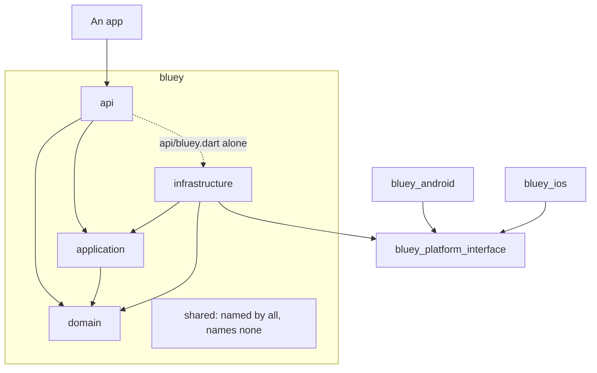

# Bluey architecture foundation: design

- **Date:** 2026-11-17
- **Status:** Approved (design)
- **Document:** https://claude.ai/artifact/NQnyEBwsoUjgTozbtw9zG2

Bluey gets one written target structure, taken from the Eventur `:common` module and the Charter Brief libraries, and a build that enforces it, before any audit fix lands. Each fix then moves the code it touches into its final place.

## Intent

The audit found 3 High and 8 Medium defects that share three structural causes: state with several owners, completions matched by position, and teardown that only one path runs. Fixing them inside today's classes would grow five files that already exceed 1,000 lines. This slice writes down the structure the fixes will land in and makes the build refuse anything that moves away from it.

**Goals**

- One authoritative description of Bluey's structure, `docs/ARCHITECTURE.md`, as the Dart translation of Eventur `:common` and the Charter Brief libraries.
- A build that holds the dependency rules, with today's violations on lists that can only shrink.
- Every test gate running on every pull request, on a pinned Flutter.
- The audit's findings filed in `docs/backlog/`, with their failing tests in the repository.

**Non-goals**

- No audit finding is fixed in this slice.
- No existing file moves in this slice. A context moves to the new layout with the fix that touches it.
- No change to the public API.
- No new tier of the test rig.

**Anti-goals**

- A restructure that changes behaviour while the suite cannot see it.
- Rules that are written down but not enforced, so the next change drifts again.
- An abstraction ahead of its shape: a layer, port or base class that no slice uses yet.

**What this design builds on.** The audit is the Claude Doc [Bluey audit: correctness and hardware-free testing](https://claude.ai/artifact/R6G8npke9CKEDaAakFyR7a). It numbers its findings H1 to H3, M1 to M8 and L1 to L12, and it defines the five tiers of the test rig (0 to 4) that this design refers to. Neither the audit nor its failing tests are in the repository at `a41a2de`. A markdown copy of the audit sits in the project files at `bluey-audit-2026-11-17/audit.md`, beside the two test files.

## Approaches

Two choices shaped this design, and Joel made both on 2026-11-17.

**When to fix structure**

| Approach | Trade-off | Outcome |
| --- | --- | --- |
| Foundation first, then structure inside each fix | A short first slice, then every fix extracts the unit that should own the behaviour and lands it in its final place | Picked. The top findings are ownership problems, so the fix and the restructure are the same change |
| Restructure everything first | Clean layout soonest, but about 11,000 lines move while the suite passes with nine known bugs in it | Rejected. The tests cannot tell a safe move from a broken one, and fixed areas get rewritten twice |
| Fix first, restructure later | Bugs close soonest | Rejected. Every fix adds code to classes that are already too large |

**How failures are reported**

| Approach | Trade-off | Outcome |
| --- | --- | --- |
| Values inside, exceptions at the facade | Ports and internal units answer `Either`, and one translator throws `BlueyException` for callers. Two models and a translator | Picked. A dropped failure becomes a compile-time matter where the audit found the bugs, and Flutter callers keep the API they expect |
| Values everywhere | Matches the Kotlin repositories end to end | Rejected. It breaks every call site |
| Exceptions everywhere | No change | Rejected. Bluey stays different from the standard |

## Where Bluey stands today

Bluey meets the standard on vocabulary and value objects and misses it on layering, boundaries and enforcement. Measured at commit `a41a2de`, over the 53 files of `bluey/lib/src`.

| The standard | Bluey today | Evidence |
| --- | --- | --- |
| Each context has domain, application and infrastructure layers | Each context is one flat folder, and four files sit outside any context | `bluey.dart` (1,002 lines), `events.dart` (540), `lifecycle.dart` (364), `event_bus.dart` |
| Domain and application name no framework and no adapter type | 13 files import `bluey_platform_interface` and one imports Flutter | I308, I309 |
| A context names only itself and the shared kernel | 27 imports cross from one context to another, and `shared/` imports four contexts | `gatt_server` imports `peer` five times; `shared/exceptions.dart` imports discovery, gatt\_server, peer and platform |
| A protocol belongs to one context | The lifecycle protocol is spread over three places, though CLAUDE.md gives it to Peer | `lifecycle.dart` at the root, `connection/lifecycle_client.dart` (836), `gatt_server/lifecycle_server.dart` (413) |
| A unit has one responsibility | Six files exceed 1,000 lines | `bluey_connection.dart` (1,657, six classes), `bluey_server.dart` (1,181), `bluey.dart` (1,002), `GattServer.kt` (1,260), `ConnectionManager.kt` (1,092), `CentralManagerImpl.swift` (1,005) |
| Failures are values | Sealed exceptions are thrown at every level | `shared/exceptions.dart` (578) |
| Architecture tests fail the build | No architecture test and no CI | I351 |
| Every port has a contract suite that its double and its real adapter both pass | `FakeBlueyPlatform` (2,791 lines) and the Android and iOS adapters share no suite | I375 |
| Tests mirror the source tree | 22 test files sit flat in `bluey/test/` beside nine folders |  |

The backlog already knows the first four rows (I308, I309, I320, I372, I373) and rates each of them low.

## Target structure

The `bluey` package takes the shape of Eventur `:common` (`features/{context}/` with `domain/`, `application/`, `infrastructure/`, beside `shared/`) plus one edge folder, `api/`, which plays the part `:api` and `:server` play in the Kotlin repositories.



An arrow reads "depends on". Only `infrastructure` touches `BlueyPlatform`, only `api` throws for a failure, and nothing points out of `domain`.

```
bluey/lib/
├── bluey.dart                      the public exports, nothing else
└── src/
    ├── api/                        the edge: what an app calls
    │   ├── bluey.dart              Bluey: assembles every context by constructor
    │   ├── exceptions.dart         the sealed BlueyException family
    │   ├── failure_translation.dart  Failure to BlueyException, the one place a failure is thrown
    │   └── {context}/              public interfaces (Connection, Scanner, Server) and their thin implementations
    ├── features/
    │   └── {context}/              discovery, connection, gatt_client, gatt_server, peer, platform
    │       ├── domain/             value objects, entities, state machines, events, failures
    │       ├── application/        one unit per intent, and the sessions that run a live state machine
    │       │   └── ports/          what this context needs from the radio or another context, in its own words
    │       └── infrastructure/
    │           ├── adapters/       a port answered over BlueyPlatform: DTO mapping, platform errors to failures
    │           └── bridges/        a port answered by another context
    └── shared/
        ├── domain/                 Either, Failure, DomainEvent, UUID, ManufacturerData, CharacteristicProperties
        ├── application/            ports every context uses: EventPublisher, Log
        └── infrastructure/         BlueyLogger, the event bus, platform error classification
```

| Layer | Holds | May name |
| --- | --- | --- |
| `features/{context}/domain` | The context's rules as pure, synchronous Dart: a state machine takes an input and answers the new state and what to do next | Its own domain, `shared/domain`, `dart:core`, `dart:typed_data`, `dart:collection`, `dart:math`, `package:meta` |
| `features/{context}/application` | Orchestration: one unit per intent (`ConnectDevice`), sessions that feed a state machine from a port's stream and run its timers, and the ports | Its own domain and application, `shared/domain`, `shared/application`, `dart:async`, `package:clock` |
| `features/{context}/infrastructure` | Adapters and bridges, and nothing that decides | Its own context, `shared`, `bluey_platform_interface`, `package:flutter/services.dart`. A bridge also names the other context's domain and application |
| `shared` | The kernel every context uses | No context, and no `api` |
| `api` | The public surface: interfaces, implementations that call one application unit and translate its failure, and the composition root | The domain and application of every context. Only `api/bluey.dart` names a context's `infrastructure` folder |

A layer folder groups by role once it holds three or more files of one kind (`value_objects/`, `events/`, `failures/`), as Eventur does. File names stay Dart's `snake_case`; class names follow the Kotlin repositories (`ConnectDevice`, `PlatformScanning`, `InMemoryScanning`).

Where today's code goes, folder by folder (each move happens in the slice that touches it):

| Today | Target |
| --- | --- |
| `bluey.dart`; `Connection`, `Scanner`, `Server` and the `Remote*` interfaces with their `Bluey*` implementations | `api/`, with the logic they hold moved down into application units and domain state machines |
| `shared/exceptions.dart` | `api/exceptions.dart`; each context gains its own sealed failures in `domain/` |
| `events.dart` | Each context's `domain/events/` |
| `lifecycle.dart`, `connection/lifecycle_client.dart`, `connection/peer_silence_monitor.dart`, `gatt_server/lifecycle_server.dart` | `features/peer/`, which owns both halves of the lifecycle protocol |
| The `_map*` methods and `connection_parameters_mapper.dart` | Each context's `infrastructure/adapters/` |
| `shared/error_translation.dart` | `shared/infrastructure/` for platform errors to failures; `api/failure_translation.dart` for failures to exceptions |
| `log/`, `event_bus.dart` | A port in `shared/application`, the implementation in `shared/infrastructure` |
| `Capabilities`, which `lib/bluey.dart` re-exports from `bluey_platform_interface` and which `Mtu` and `Bluey.capabilities` name | Bluey's own `Capabilities` value object in `shared/domain`, mapped from the platform interface's type by an adapter, as `PlatformDevice` becomes `Device`. Slice 1 makes the move, because `Mtu` moves with Connection |

## Rules the build holds

An architecture test in `bluey/test/architecture/` fails the build when a rule below is broken, as `ModuleArchitectureContract` does in Charter Brief. It reads each file's `import` and `export` lines, places the file by its path, and needs no new dependency.

| Rule | What it checks |
| --- | --- |
| Layers | A file names only what its layer may name (the table above) |
| Boundaries | A context names no other context outside `infrastructure/bridges/`, and `shared` names no context |
| Framework placement | `package:flutter` and `bluey_platform_interface` appear only under `infrastructure/` and in `api/bluey.dart`, and `lib/bluey.dart` exports from `src/` alone |
| Throws | Under `features/` and `shared/`, the only `throw` is a programming error (`StateError`, `ArgumentError`, `UnimplementedError`), and no stream gets `addError` |
| Placement | Every file under `lib/src` is in the target layout or on the unplaced list |
| Size | No hand-written Dart file under `lib/` in any of the four packages exceeds 300 lines, and no Kotlin or Swift source exceeds 400 |

Today's violations go on lists in `test/architecture/known_violations.dart`, and each list is a ratchet:

- A violation that is not on its list fails the test.
- A list entry that no longer violates also fails the test, with a message to delete it. A list can only shrink.
- The size list records each oversized file with its current line count as its ceiling. The file may shrink and may not grow.
- The unplaced list starts with all 53 files. A new file must be born in the target layout.

A file that is not yet placed is still held to the boundary and framework rules by the folder it sits in today (`connection/`, `shared/`). Those violations are what the lists start with.

Two entries on today's lists can only be cleared by a named slice. `lib/bluey.dart` re-exports `Capabilities` from `bluey_platform_interface`, and slice 1 clears it. `bluey_platform_interface/lib/src/platform_interface.dart` is 854 lines, nearly all of it the one `BlueyPlatform` class, so its ceiling makes slice 3 split it into one interface per role before slice 4 adds operation ids to it. Seven more Dart files in the other three packages start on the size list.

Three more guards sit beside the architecture test:

- **Public API dump.** The names and signatures `bluey/lib/bluey.dart` exports are committed as a text file, and a check fails when the two differ, as `checkKotlinAbi` does in Charter Brief. Moving code behind the facade cannot change the public API by accident.
- **Stricter lints for placed code.** A nested `analysis_options.yaml` in each target folder turns on `unawaited_futures` and `discarded_futures`. Those two flag 61 dropped futures in `bluey/lib` today, the class of bug behind finding M2. The old folders keep today's lints until they are empty.
- **Coverage.** CI fails under 90% line coverage for the `bluey` package, the figure CLAUDE.md already requires (90.5% today).

## Failures as values

Below `api/`, a failure a caller can meet is answered as `Either<Failure, T>` and never thrown. `api/` is the one place that turns a failure into a `BlueyException`.

```dart
// features/connection/application/connect_device.dart
Future<Either<ConnectionFailure, Link>> run(ConnectDeviceRequest request)

// api/bluey.dart
Future<Connection> connect(Device device, {Duration? timeout}) async =>
    (await _connectDevice.run(ConnectDeviceRequest(device, timeout)))
        .fold(throwAsBlueyException, _connections.wrap);
```

- **`Either`** is Bluey's own sealed type in `shared/domain`, with `Left`, `Right`, `then`, `map` and `fold`, mirroring the kernel's. No package is added.
- **`Failure`** is an interface in `shared/domain`. Each context declares its own sealed family (`ConnectionFailure`, `ScanFailure`) in its `domain/`, because Dart seals a family within one file. A failure carries typed fields, never a map.
- **The translator** in `api/failure_translation.dart` switches exhaustively over each family, so a new failure with no public exception fails to compile.
- **Adapters** catch everything `BlueyPlatform` throws and answer a failure. A throw they do not recognise becomes an `UnexpectedPlatformFailure` that carries the cause; it is never swallowed.
- **Streams** below `api/` carry no errors. A stream whose source can fail ends through its owner's terminal state or carries `Either`; each port's design says which.
- **Input is parsed.** Bytes and values that arrive from the radio, the platform or a remote peer go through a factory that answers `Either` (`LifecycleInterval.of`). A throwing constructor is only for a value the app's programmer wrote (`UUID('180d')`).
- **Programming errors still throw.** A broken invariant is a `StateError`, as `error(...)` is in the Kotlin repositories.

Both models coexist while contexts move: an unplaced file keeps throwing, and a placed file is held to the rule by the architecture test.

## State and ports

Three rules answer the audit's three structural causes, and every later slice is reviewed against them.

| Rule | What it means | Findings it answers |
| --- | --- | --- |
| One owner per state | Scanning, advertising, each link and the set of live links are each one state machine in one context's domain. A platform stream is an input to that machine, never a second copy of the state in an adapter or a native class | M2, M3, M4, M5, M8, L1, H2 |
| Completion by identity | An operation that crosses to native code and completes later carries an id its caller minted. A completion names that id, and one that names an unknown id is logged and dropped | H1, M1, I063, I359 |
| Teardown is a transition | Reaching a terminal state releases every resource, whatever caused it. `disconnect()` and `dispose()` request the same transition a remote disconnect causes | H3, I369, L4, L5 |

**Ports.** `BlueyPlatform` stays as the federated plugin interface that Android and iOS implement, and it becomes infrastructure's dependency instead of the domain's (I309).

- Each context declares the ports it needs in `application/ports/`, named in its own language and answering `Either`: Discovery asks for `Scanning`, not for `BlueyPlatform`. The exact ports are settled in the slice that moves the context.
- An adapter in `infrastructure/adapters/` answers a port over `BlueyPlatform` (`PlatformScanning`). It maps DTOs and errors and decides nothing.
- When one context needs another, it declares a port and a bridge answers it. Peer reaches a link through its own `PeerLink` port, never by importing Connection.
- `api/bluey.dart` assembles everything by constructor. There is no container and no singleton.

**Contract suites.** Every port has a suite of the promises it makes, kept in `test/fixtures/` and run against its in-memory double and against its adapter over `FakeBlueyPlatform`, as `ModifyContract` and `MessagingStorageContract` run in the Kotlin repositories. A unit test that passes against the double then means the same thing against the adapter. `BlueyPlatform` gets a suite of its own that `FakeBlueyPlatform` and the Android and iOS Dart adapters all pass; that suite is tier 1 of the test rig and has its own slice.

## Native packages and tests

**Native code** follows the split Charter Brief makes between a pure core and its adapter (`:messaging` beside `:messaging-exposed`). This slice records the rule and sets the size ceilings; the native slice does the moving.

- Kotlin leaves its single package for one package per context, named as in Dart. The logic that decides (the operation queue, registries, state machines) is plain Kotlin that imports no `android.*`, and the classes that touch `BluetoothGatt` are adapters around it.
- Swift makes the same split with protocol seams, which is what I350 asks for on the central side.
- The pure cores are what tier 2 of the test rig drives with a simulated peer, so the structure and the rig need the same change.

**Tests** follow the conventions of both Kotlin repositories.

- A test file mirrors its source file's path: `lib/src/features/connection/domain/link_state.dart` is tested by `test/features/connection/domain/link_state_test.dart`. Existing tests move with their source.
- `group` blocks name the scenario, as `@Nested` classes do, and each test is laid out with `// arrange`, `// act`, `// assert`.
- Application units are tested against in-memory doubles of their ports (`InMemoryScanning`), kept in `test/fixtures/` under the same tree. No mocks.
- `FakeBlueyPlatform` stays, for adapter tests and the integration tests that run whole scenarios through `api/`.

**Known defects.** The audit's eleven failing tests are committed under `test/known_defects/` with the tag `known-defect`, in `bluey` and in `bluey_android`. The normal gate leaves the tag out. A separate CI job runs only that tag and fails when one of its tests passes, which is the signal that the test belongs in the mirrored tree. Each fix slice starts by moving its test there, as its red step.

All eleven are Dart tests: nine in `domain_audit_repro_test.dart` for `bluey` and two in `android_adapter_audit_repro_test.dart` for `bluey_android`. They reproduce nine findings: H2, H3, M2, M3, M4, M5, M6, M7 and L1. Their names carry working ids from before the audit was numbered, and each is renamed to its finding when committed: F-D1 is H2, F-D2 is H3, F-D6 is M6, F-D7 is L1, F-D8 is M7, F-D9 is M4, F-D10 is M5, F-A1 is M3 and F-A2 is M2. The findings traced by reading have no test yet. Each gets one as the red step of its own slice, so this slice needs no known-defect mechanism for Kotlin or Swift.

## What this slice delivers

Seven things, none of which changes behaviour.

1. `docs/ARCHITECTURE.md`, holding the structure, rules, failure model, state rules and test conventions above as the standing guide. `CLAUDE.md` becomes its short version and gains the rule both Kotlin repositories have: every spec and plan carries a design review that ends `Verdict: ready.` before any task starts.
2. `Either` and `Failure` in `shared/domain`, written test first. They are the only production code in the slice.
3. The architecture test with its lists, the public API dump and its check, and the nested lint options.
4. A pinned Flutter version and a committed lockfile, so a fresh checkout resolves. This closes L12.
5. CI on GitHub Actions (I351). Every pull request runs analyze, the four Dart suites, the architecture test, coverage and the Kotlin JVM tests on Linux. XCTest runs on macOS for pull requests that touch `bluey_ios/` and once a night. The known-defect job runs with them.
6. The audit's findings filed in `docs/backlog/` and on the roadmap, with I308, I309, I320, I372 and I373 re-rated and tied to the slice that closes each.
7. The eleven known-defect tests, committed.

**Filing the findings.** The audit itself is committed as `docs/reviews/2026-11-17-correctness-and-test-rig-audit.md`, beside the two earlier reviews, so backlog entries and `docs/ARCHITECTURE.md` can cite it. A finding that the audit's re-rate table ties to an existing item is written into that item: H1 into I063, M1 into I359, M2 into I013, M3 into I369 and M4 into I336. L12 is written into I351 and closes with it. The other 17 findings each get a new entry under the backlog's own id rules, with the items the audit calls related in `related:`.

**When a gate is red.** On Flutter 3.47.2 at `a41a2de`, `flutter analyze` is clean on a clean tree and the four Dart suites pass. The Kotlin and XCTest suites could not be run where this design was written, so the plan's first task runs both once on Joel's Mac and their state is known before a workflow is written. A build or configuration cause is fixed in this slice. A failing test is filed and brought to Joel before the slice goes on. No test is skipped and no gate lands as non-blocking to get a green run.

## The slices after it

Each slice gets its own short design with its own design review, lands as its own pull requests, and moves the context it touches into the target layout.

| # | Slice | Findings it closes | Structure it lands |
| --- | --- | --- | --- |
| 1 | Link lifecycle | H3, M3, L6, I369, then H2, L9, I374 | Connection in the target layout: a link state machine that owns teardown, a registry of live links, the `Links` port and its adapter. Bluey's own `Capabilities` |
| 2 | Scanning and advertising sessions | M2, M4, M5, L1, the Dart half of M8, I013, I336, I320 | Discovery in the target layout, and an advertising session inside GATT Server |
| 3 | Platform contract suite and invariants | I375 | Rig tiers 0 and 1: `BlueyPlatform` split into one interface per role, a `bluey_testing` package with `FakeBlueyPlatform`, the `BlueyPlatform` contract suite and the scenario language, plus random-sequence invariant tests over the state machines of slices 1 and 2 |
| 4 | Native completions | H1, I063, M1, I359, I350, L3, L4, L10, the native half of M8 | Kotlin and Swift pure cores, operation ids across Pigeon, rig tier 2 |
| 5 | Server and Peer | M6, M7, L2, L5, L8, L11, I373 | GATT Server free of the protocol, and Peer owning both halves of it through ports and bridges |
| 6 | What is left | L7, I304, then I308, I309 and I372 | GATT Client and Platform placed, every list empty, then the decision on rig tier 3 |

Slice 3 comes before slice 4 so that the native changes are proved against the port's promises.

I308, I309 and I372 shrink with every slice and close in slice 6, when the last context is placed and no file is over its ceiling.

## Calls I made

These are my choices, not Joel's, and each is open to correction.

| Call | Why | The alternative |
| --- | --- | --- |
| An `api/` folder holds the public interfaces, their implementations and the exceptions | Something must throw for callers, and the contexts may not. It stands where the edge modules stand in the Kotlin repositories | Keep public interfaces inside each context and let them throw |
| Ports per context, with `BlueyPlatform` kept beneath them | Each context speaks its own language and depends on a few methods instead of all of them | One port for all contexts, as today |
| Domain state machines are synchronous and hold no timers | A pure machine can be tested with random input sequences, which is tier 0 of the rig | Timers and streams inside the domain |
| `Either` is written by hand | The domain takes no dependency, and the type is about 40 lines | `fpdart` or `dartz` |
| No new package for a pure core | The architecture test holds purity, and a package boundary would add a publish step for no caller | A `bluey_core` package without Flutter |
| Size ceilings of 300 lines for Dart and 400 for Kotlin and Swift | A ceiling stops a fix from growing a class that is already too large. The numbers are a judgment | No size rule, as in Charter Brief |
| The size rule covers the Dart of all four packages | The adapters hold the same kind of oversized class the domain does. It also makes `BlueyPlatform` split by role in slice 3, which is what a contract suite per role needs | Hold only `bluey/lib` to it |
| Each context gets its own sealed event family under a `BlueyEvent` marker | Dart seals a family within one file, and one file for every context's events is the coupling this design removes | Keep one sealed `BlueyEvent` in `api/` and mirror all 34 events there |
| Bluey owns `Capabilities` in `shared/domain`, and the platform interface's type becomes the DTO it is mapped from | `Mtu`'s public factory takes it and three contexts read it, so the domain cannot be free of platform types while it is re-exported. The public name and members stay | Keep the re-export as a standing exemption from the framework rule |
| XCTest runs only for pull requests that touch `bluey_ios/`, and nightly | macOS runners cost more than Linux ones | XCTest on every pull request |
| Known-defect tests live under a tag, with a job that fails when one passes | The tests stay in the repository and visible without turning the main gate red | Keep them outside the repository until their slice |
| A red native gate stops the slice | A gate that does not block is the unenforced rule this design rules out | Land CI with the red job allowed to fail |
| Proposed ratings: each audit finding at the audit's severity, the audit's re-rates as written, and I308, I309, I372 and I373 raised from Low to Medium | They are the causes the fixes are now built around. The roadmap leaves priorities to the maintainer, so this is a proposal | Leave the four structural items Low |

Two of these calls can touch an app, and each takes effect in the slice that makes the move, not in this one. After the event call, code that switches exhaustively over every `BlueyEvent` needs a default branch; the example app has no such switch. After the `Capabilities` call, code that imports both `bluey` and `bluey_platform_interface` sees two types of that name; code that imports `bluey` alone compiles unchanged.

## Left to the builder

- How the architecture test reads and reports; Charter Brief's `SourceTree` and `LayerRules` are the model.
- The tool behind the public API dump, as long as a committed dump and a failing check result.
- Which Flutter version is pinned and how the `analyzer` conflict behind L12 is resolved. Flutter 3.47.2 resolves today.
- The workflow files, caching, and the mechanics of the known-defect job.
- How `docs/ARCHITECTURE.md` is divided into sections.

## Design review (cohesion, coupling, DDD, Clean Architecture)

- **Bounded context and language.** The six contexts and their glossary are CLAUDE.md's and do not change: Discovery, Connection, GATT Client, GATT Server, Platform, Peer. This slice adds no domain term. Its new words are structural and come from the two Kotlin repositories: port, adapter, bridge, contract suite, failure, unit of intent. `Either` and `Failure` belong to the shared kernel and name no context.
- **Each unit's single responsibility.** `Either` carries one of two outcomes. `Failure` marks a value as a failure a caller can meet. The source reader of the architecture test lists a file's imports and places the file; each rule checks one rule; the violations file holds the lists and nothing else. The API dump check compares the exported surface with its committed text. Each CI job runs one gate. `docs/ARCHITECTURE.md` describes the structure, and `CLAUDE.md` points to it.
- **Cohesion.** The rules sit together in `test/architecture/`, as they do in Charter Brief's `kernel/testing/architecture`. `Either` and `Failure` sit together because every signature below `api/` uses both. Nothing is filed by technical kind across contexts: the target layout is by context first, layer second.
- **Coupling, and each dependency's direction.** `domain` ← `application` ← `infrastructure`, and `api` → `application` and `domain`. `shared` is named by all and names none. `infrastructure` → `bluey_platform_interface` ← `bluey_android`, `bluey_ios`. A context reaches another only through its own port and a bridge. The architecture test depends on file paths and import lines alone, so it holds while files move. Nothing in this slice makes production code depend on a test or on CI.
- **No abstraction ahead of its shape.** No port, adapter, bridge, state machine or use-case base type is written here; each arrives in the slice that uses it. `Either` and `Failure` are the exception because slice 1 cannot write its first signature without them. No generic repository and no container is introduced.
- **Layers.** `Either` and `Failure`: `shared/domain`. The architecture test, the lists and the known-defect tests: `test/`. The API dump: a committed text file beside the package. Lint options: nested `analysis_options.yaml` files. CI: `.github/workflows/`. No file under `features/`, `api/` or any `infrastructure/` is created in this slice.
- **Risk to behaviour.** No existing source line changes, so the 1,120 passing tests and the public API are untouched. The lists start from what is true today, so the first run is green.
- **Claims checked against source** (at `a41a2de`).
  - `bluey/lib/src` holds 53 Dart files. 13 import `bluey_platform_interface`, and `shared/error_translation.dart:3` imports `package:flutter/services.dart`.
  - Beyond those two, the only packages the 53 files import are `meta` (24 files) and `clock` (1), and the only SDK libraries are `dart:async`, `dart:collection`, `dart:math` and `dart:typed_data`. The layer table allows each of them somewhere.
  - `bluey_platform_interface` imports `dart:typed_data`, `meta` and `plugin_platform_interface` only, so it names nothing of `bluey`.
  - `BlueyException` (`shared/exceptions.dart:13`) and `BlueyEvent` (`events.dart:12`) are each sealed in one file; `exceptions.dart:3-6` imports discovery, gatt\_server, peer and platform; `events.dart` declares 34 classes.
  - `bluey/lib/bluey.dart` holds exports only, so moving a file changes one export line and no public name.
  - The repository has no `.github/`, no root `analysis_options.yaml`, no `dart_test.yaml` and no committed root lockfile (`git ls-files`).
  - `bluey/pubspec.yaml` says `publish_to: none` and version `0.3.0`.
  - With `unawaited_futures` and `discarded_futures` on, `dart analyze lib` in `bluey` on Flutter 3.47.2 reports 61 hits (60 and 1).
  - The example app listens to `bluey.events` in three places and never switches exhaustively over `BlueyEvent`.
  - Charter Brief's `MessagingArchitectureTest` and `kernel/testing/architecture/SourceTree.kt` read source files and import lines, the method the architecture test here copies. Eventur's `docs/ARCHITECTURE.md` sets the folder layout, the three-file grouping rule and the contract-suite rule this design translates.

**Claims added after the builder check** (at `a41a2de`). `bluey/lib/bluey.dart:55-56` re-exports `Capabilities` from `bluey_platform_interface`, and `connection/value_objects/mtu.dart:17` takes it in `Mtu`'s factory. Eight hand-written Dart files in the other three packages exceed 300 lines, the largest `platform_interface.dart` at 854. The two reproduction files hold eleven tests, nine and two, for nine findings. `flutter analyze` reports no issues on a clean tree on Flutter 3.47.2.

Verdict: ready.
